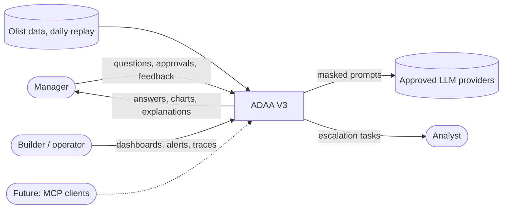
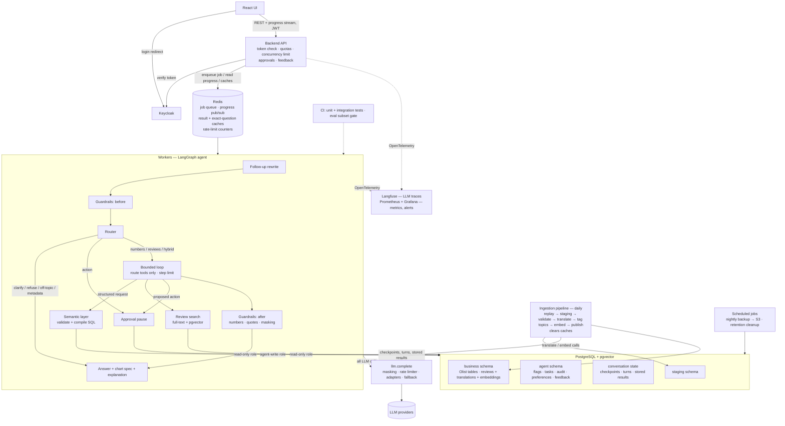

# V3 Problem Statement

**Status:** 🔒 **Plan locked.** Problem definition complete. High-level decisions D1–D7 locked (sections 11–17);
D8: a minimal deployment is **core** (hosting and cost details decided in design). D9 (plan-first vs bounded agent loop) is open.
Next: data profiling, then detailed technical design.

> ⚠️ **Before designing or building V3, read [v3-requirements.md](v3-requirements.md)** — the
> non-functional requirements (load, latency, cost, availability, security, rate limits,
> observability). They must be considered up front and drive the design.
**Related:** [v2-polish-plan.md](v2-polish-plan.md) (V2 polish, done first; produces the frozen `v2.0` baseline)

---

## 0. Clean-slate design (started 2026-10-11)

V3 is being re-designed top-down (Level 0 → Level 1 → Level 2), one decision at a time, asking
"why this, why not that". **Sections 1–20 below are now a reference checklist, not locked
decisions** — each is re-decided here and only then counts as locked.

### Level 0 — Problem statement (🔒 locked)

> An AI agent that answers natural-language questions over a company's internal data, covering both
> structured records (tables) and unstructured text (such as customer reviews). It shows how it got
> each answer, asks when a question is unclear, and refuses when the data can't answer it. It runs
> as a deployed, multi-user service.

### Level 0 — Primary user (🔒 locked)

**A business manager with no SQL knowledge.** Asks in plain English and **cannot verify the
answer**, so trust is the central requirement: explain how each answer was computed, ask when
unclear, refuse rather than guess (a confident wrong number is worse than "I can't answer").
Rejected: data analyst (checks the SQL themselves, so trust behaviours become optional), executive
(summaries only, too narrow).

### Level 0 — Pain and value (🔒 locked)

Today a manager waits hours or days for an analyst to answer a routine data question, and
dashboards only answer questions someone predicted in advance. The agent gives a **trusted answer
to an unplanned question in seconds**. Value metric: **time to a trusted answer**. A change that
is faster but less trustworthy does not serve this pain.

### Level 0 — Read-only vs actions (🔒 locked, after dataset and question types)

**Business data is read-only.** One write action — flag a seller or create a task — saved only in
the agent's own tables, with manager approval first, logged, and undoable. Report export: later.
Details: [ADR 0002](adr/0002-read-only-business-data-one-approved-action.md).

### Level 1 — Dataset criteria (🔒 locked)

Must-have: (1) real company data, not synthetic/teaching; (2) several related tables needing
joins; (3) real mess (missing values, duplicates, lookup codes); (4) customer text from the same
business, linked to the records. Preferred: (5) questions a manager would really ask; (6) workable
size (laptop, free/cheap API tiers); (7) license allows a public portfolio repo; (8) room for
actions the agent could plausibly take.

### Level 1 — Dataset (🔒 locked)

**Olist Brazilian E-Commerce.** Only candidate meeting all must-haves; reviews linked to orders.
Details, rejected alternatives and consequences: [ADR 0001](adr/0001-olist-dataset.md).

### Level 1 — Question types (🔒 locked)

Two independent axes. **Context:** (A) standalone; (B) follow-up — rewritten into a standalone
question using earlier turns, then handled as usual.

**Need** (all checked against Olist):

| # | Type | Example | Expected behaviour | Scope |
|---|---|---|---|---|
| 1 | Numbers | "Late-delivery rate by seller in 2017?" | Query tables, answer, explain computation | Core |
| 2 | Review text | "What do customers complain about?" | Search reviews, summarise, cite | Core |
| 3 | Hybrid | "Worst categories for late delivery, and what do those customers say?" | Numbers → reviews filtered by that result → one answer | Core |
| 4 | Ambiguous | "Who are our best customers?" | Ask or state the assumption | Core |
| 5 | Unknown business term | "What's our GMV?" | Map to a defined metric or ask | Core |
| 6 | Unanswerable (incl. false premise) | "What's our profit?" (no cost data) / "Why did sales drop in 2019?" | Refuse naming the missing data, or correct the premise | Core |
| 7 | Off-topic | "Write me a poem" | Decline, say what it can do | Core |
| 8 | Metadata | "What date range is the data?" | Describe data and capabilities | Core |
| 9 | Personal data request | "List customer IDs and zip codes" | Refuse (Olist is anonymised, but IDs/zip prefixes are quasi-identifiers) | Core |
| 10 | "Why" / forecast | "Why did reviews drop in March?" | Decide after core works (can show associations, not prove causes) | Later |

Prompt injection is a safety concern, not a question type — handled separately.

### Level 0 — Success criteria (🔒 locked)

Broad goals; each gets one or more eval metrics (formula, test questions, pass mark) in the eval
design step. Every failure is labelled with its **cause** (e.g. routing, retrieval), not blended
into one pass rate.

| # | Criterion | Measured as (detail in eval design) |
|---|---|---|
| S1 | Correct numbers | % of number questions answered correctly |
| S2 | Correct review answers | Right reviews found; summary says only what they say |
| S3 | Right source chosen | % routed correctly to numbers / reviews / both |
| S4 | Asks when unclear | Asks on ambiguous questions, not on clear ones |
| S5 | Refuses when it should | Refuses unanswerable / off-topic / personal-data, not answerable ones |
| S6 | Never silently wrong on messy data | No wrong numbers on known data traps |
| S7 | Explains every answer | Every answer has "how this was computed" |
| S8 | Safe actions | No action runs without approval |
| S9 | Production targets met | Latency, cost, load targets (set in the requirements step) |

### Level 0 — Non-goals (🔒 locked)

- A general "chat with any database" product — one realistic company dataset, done properly.
- Editing business data ([ADR 0002](adr/0002-read-only-business-data-one-approved-action.md)).
- Interface languages other than English (Portuguese reviews are handled internally).
- Live/streaming data — Olist is a snapshot; at most a simulated daily refresh.
- Fine-tuning models.
- Anything from the builder's employer work.

Whether the LLM may write SQL is **not** a Level 0 rule — it is a Level 1 architecture decision.

**Level 0 complete.**

### Level 1 — Usage scenario (🔒 locked, may be revisited during design)

Olist's internal analytics assistant: **500** registered managers; **~20** concurrent normally;
**~100** at peak (Monday reporting) — the design point, where speed targets must hold; **200**
spike — survive only (queue or polite "busy", never crash or wrong answers, speed not required).
~1 question/min per active user at peak → **~1.7 questions/s**, **~5–7 LLM calls/s**. Free LLM
tiers can't sustain that — deliberately, so caching, cheaper models and queuing become design work.

### Level 1 — Speed targets (🔒 locked)

Targets hold at the **100-user peak**. p50 = half of answers faster; p95 = 19 of 20 faster.

| Measure | p50 | p95 |
|---|---|---|
| **Time to first feedback** (any progress shown, e.g. "Searching reviews…") | < 1s | < 2s |
| **Total time** — clarify / refuse / off-topic / metadata | < 2s | < 4s |
| **Total time** — numbers | < 5s | < 10s |
| **Total time** — review text | < 6s | < 12s |
| **Total time** — hybrid | < 10s | < 20s |

**Tracked, no target (diagnostics):** time to first answer token (TTFT), output speed (tokens/s),
per-step time (router, planner, database, review search, each LLM call), queue wait, p99.
**Why first feedback, not TTFT:** the agent routes, plans and queries before writing, so the first
answer token arrives late; progress messages are what the manager sees first. Implies streaming
progress to the UI.

### Level 1 — Cost target (🔒 locked as a soft baseline)

**Baseline: < $0.01 per question on average** (~55k questions/month → ~$550/month). A soft
baseline, not a fixed limit — reviewed after first measurements. Cost tracked per question type
(hybrid will cost more). Business framing: an analyst answering the same question costs dollars.

### Level 1 — Failure behaviour and uptime (🔒 locked)

| Failure | Required behaviour |
|---|---|
| LLM provider down / rate-limited | Switch to a backup model or provider; else a clear error — **never a made-up answer** |
| Database down | Clear error; never a partial or old answer presented as current |
| Anything slow | Every external call has a time limit; each question has an overall time cap |
| Uptime | 99.5% during business hours (≈40 min/month), measured in load tests and the demo period |

Rule: an honest error beats a confident guess. The backup-provider requirement implies LLMs are
called through one owned interface, not tied to a vendor (V2's single-vendor coupling hid a
deprecated-model failure).

### Level 1 — Security and privacy (🔒 locked)

Core:
1. Every manager logs in; every request is tied to a person (audit, per-user limits, approvals).
2. Least privilege in the database: read-only on business data; narrow write only to agent-owned
   tables ([ADR 0002](adr/0002-read-only-business-data-one-approved-action.md)).
3. No personal data in answers or logs beyond what's needed (customer IDs, zip codes masked).
4. Prompt-injection resistance, including instructions hidden inside review text — reviews are
   untrusted input entering prompts; needs a written threat model and defences.

Parked (stretch): role-based data access (e.g. regional manager sees only their region).

### Level 1 — Overload and abuse controls (🔒 locked)

1. **Per-manager quota** — start at 30 questions/hour.
2. **Global concurrency limit** — at most N questions in progress; the rest queue.
3. **Provider rate limits enforced centrally** — one place counts LLM calls/min and holds back
   before the provider's limit (most common way LLM apps fail under load).
4. **Polite rejection** — "hourly limit reached, try in 12 min" / "busy, you're #3 in queue".

Numbers are starting values, tuned during load testing.

### Level 1 — Data requirements (🔒 locked)

1. **Daily freshness** — new orders and reviews loaded, translated and searchable within 24h
   (simulated by replaying the snapshot day by day): an ingestion pipeline, not a one-off script.
2. **Growth headroom** — speed targets hold at 10× today's data (synthetic scale-up, test only).
3. **Consistent data rules** — messy-data handling defined once, applied to every answer (protects S6).

### Level 1 — Observability (🔒 locked)

1. **Every question traced end to end** — route, each step, reviews retrieved, every LLM call
   (prompt, tokens, cost, time), outcome.
2. **Dashboard** — p50/p95 per question type, error rate, cost per question, question-type mix,
   cache hit rate, quota rejections.
3. **Alert conditions defined** — e.g. p95 above target for 10 min, error rate > 2%, cost per
   question > 2× baseline.
4. **Manager feedback** — 👍/👎 per answer, linked to its trace; bad answers become new test questions.

**Non-functional requirements complete** (scenario → observability above). These supersede the
draft in [v3-requirements.md](v3-requirements.md).

### Level 1 — How numbers are computed (🔒 locked)

**Semantic layer.** We define metrics, dimensions, joins and messy-data rules once; the LLM only
fills a structured request, which code validates and compiles to SQL. Text-to-SQL is built as the
comparison baseline. Details: [ADR 0003](adr/0003-semantic-layer-for-numbers.md).

### Level 1 — Database (🔒 locked)

**PostgreSQL** — the database enforces least privilege and query time limits; handles 100
concurrent users. Rejected DuckDB (no permissions) and SQLite. [ADR 0004](adr/0004-postgresql.md).

### Level 1 — Portuguese reviews (🔒 locked)

**Translate once at load time** (part of the ingestion pipeline, never at question time); store
both versions; search the English. Direct-Portuguese-search comparison: nice-to-have (stretch).
[ADR 0005](adr/0005-translate-reviews-at-load-time.md).

### Level 1 — Review search (🔒 locked)

**Hybrid search** (PostgreSQL full-text + vector similarity), vectors in **pgvector** — chosen on
its own merits: filtering by order data in one query, scale fit, no sync, one security boundary.
[ADR 0006](adr/0006-hybrid-review-search-in-pgvector.md).

### Level 1 — Agent shape (🔒 locked)

**Bounded loop:** pick an allowed tool → see result → next step, with a hard step limit, allowed
tools only, and a check after each step; pauses for approval before actions. Plan-first built as a
comparison. [ADR 0007](adr/0007-bounded-agent-loop.md).

### Level 1 — Routing (🔒 locked)

Follow-up rewrite → **separate router** → (early exit for clarify / refuse / off-topic / metadata)
or bounded loop with only that route's tools. Classifier type: Level 2.
[ADR 0008](adr/0008-separate-router.md).

### Level 1 — LLM interface (🔒 locked)

All code calls one owned `llm.complete(job, ...)`; behind it, **official SDKs in two adapters** (`anthropic`, `openai_compatible`); provider, model, thinking effort and price per job in config (LiteLLM removed 2026-10-20).
Model per job + fallback chain in config, chosen by evals.
[ADR 0009](adr/0009-llm-interface-litellm-behind-owned-port.md).

**Every LLM call has a defined output schema (🔒 locked 2026-10-13).** Each job declares a Pydantic
model; `llm.complete` requests it via the provider's strict JSON-schema mode where supported,
validates the reply, retries once with the validation error, then falls back to the next model.
No code parses free text. Prose (the answer text) is a field inside the schema. Examples: router
→ {route, reason}; rewrite → {standalone_question, is_follow_up, referenced_result_ids}; agent →
structured / search request; topic tagging → {topics[]}; answer → {text, chart_spec, quotes[]}.
Model choice must check schema support.

### Level 1 — Service shape (🔒 locked)

**Backend API + durable job queue + workers; UI is a client** with streamed progress. Why:
approval pauses, durability across restarts, spike handling, one place for login/quotas/tracing;
plus the learning goal. [ADR 0010](adr/0010-backend-service-with-job-queue.md).

### Level 1 — Agent framework (🔒 locked)

**LangGraph**, checkpoints in PostgreSQL (approval pause, resume after restart, step limits).
**No RAG framework** — review search is plain SQL. [ADR 0011](adr/0011-langgraph-no-rag-framework.md).

### Level 1 — Guardrails (🔒 locked)

One separate layer, three points: **before** (off-topic, personal data, injection), **during**
(validate structured request; review text marked untrusted), **after** (every number must appear
in the query result, quotes must match reviews, personal data masked — else block/retry). Code
first, LLM judge only where needed. [ADR 0012](adr/0012-guardrails-layer-three-points.md).

### Level 1 — Short-term memory (🔒 locked)

Last ~5 turns as question + structured request + one-line summary; big results stored and
referenced by ID; older-turn summary only if tests show a need.
[ADR 0013](adr/0013-short-term-memory-compact-turns.md).

### Level 1 — Long-term memory (🔒 locked, core)

Only **preferences the manager explicitly asks to save**; per manager, viewable and deletable;
any preference used is stated in the answer's explanation. No automatic memory.
[ADR 0014](adr/0014-long-term-memory-explicit-preferences.md).

### Level 1 — Observability tools (🔒 locked)

**Langfuse Cloud** (LLM traces, cost, prompt versions; not self-hosted — too heavy for one VM) + **Grafana Cloud** (hosted Prometheus-style metrics) (system metrics,
dashboard, alerts), both fed via **OpenTelemetry**. [ADR 0015](adr/0015-langfuse-plus-prometheus-grafana.md).
**Queue metrics (added 2026-10-23, M1.4; build in M6):** jobs waiting in the queue (depth),
jobs running, jobs done and failed (counts and rate), job time p50 / p95, oldest waiting job
age, and workers alive. Alerts: queue depth or oldest-job age above a limit (add workers),
failed-job rate above a limit, no worker alive. Locally: Flower (Celery's dashboard) and
`redis-cli LLEN celery`.

### Level 1 — Caching (🔒 locked)

**(a) Result cache** keyed on the structured request (different phrasings → same request → same
hit) + **(b) exact-question cache**. All caches cleared at each daily data refresh. Rejected for
core: similar-meaning (semantic) cache — "revenue in SP" ≈ "revenue in RJ" can return a wrong
answer; stretch only, behind a strict check.

### Level 1 — UI (🔒 locked)

**React single-page app (Vite + TypeScript)**, thin client of the backend; login and per-manager
screens. [ADR 0016](adr/0016-react-ui.md).

### Level 1 — Deployment (🔒 locked, provisional)

**AWS EC2** for now — one VM running the same Docker Compose as local. Better options (managed
services, CI/CD, Terraform) explored after development is complete. Known weakness: one machine
is a single point of failure — documented, with a scale-up path.

**Running mode (locked for now, revisit after development): wake on demand.** The React UI is
hosted as static files on free hosting (always on). While the backend sleeps, the page shows
"Demo is asleep — wake it up (~2–3 min)" plus demo video and screenshots. The wake button calls a
small serverless function (AWS Lambda) that starts the EC2 server; the UI polls a health endpoint
and shows startup progress; the server auto-stops after ~30 min idle. Guards: wake-up limit per
day + bot check, guaranteed auto-stop, AWS budget alarm. Wake comes before login (Keycloak is on
the server). Cost ≈ server hours + ~$3–5/month disk/IP. Alternatives for later: Oracle Cloud
always-free ARM (24 GB, $0, not AWS), Hetzner (~€7–10/month), serverless redesign.
Consequence for containers: the proxy no longer serves the UI files, only `/api` and `/auth`.

### Level 1 — Eval structure (🔒 locked)

- **~150 test questions**, builder-written across all 9 types + follow-ups + attacks (LLM drafts
  allowed, every one human-reviewed); written incrementally as each part is built.
- **Ground truth:** numbers = hand-written SQL independent of the semantic layer; reviews =
  hand-labelled relevant reviews; clarify/refuse = expected route.
- **60/40 dev / held-out split** — tune on dev, report held-out only.
- **3 runs per question** — report mean and "passes all 3" (pass^k).
- **Failure-cause label** per failure (router, request, retrieval, guardrail, answer, …).
- **CI gate:** fast subset on every code/prompt change; full set before releases.
- Eval tool (own harness / DeepEval / Ragas / Langfuse datasets): decided later.

### Level 1 — LLMOps (🔒 locked, all mandatory)

- **Prompts versioned in git** (source of truth; Langfuse may display them); every trace records
  prompt version + model.
- **Model-per-job config** in a versioned file, never hard-coded.
- **Release rule:** a prompt or model change merges only if the CI eval subset passes within a set
  tolerance; full eval before a release.
- **Side-by-side comparison** old vs new, per question type, incl. cost.

### Level 1 — Testing beyond evals (🔒 locked)

| Level | Checks | LLM | When |
|---|---|---|---|
| Unit | One piece alone (SQL compilation, number-check guardrail) | No | Every change |
| Integration | Real PostgreSQL/Redis in Docker (read-only role can't write, job survives restart, approval resumes) | Faked | Every change |
| End-to-end | Key flows through the API (login → ask → stream → answer) | A few | Before release |
| Failure injection | LLM timeout → backup; DB down → clear error | No | Before release |
| Load test | Speed at 100 users, survival at 200 (Locust/k6) | Yes | Before release |

### Level 1 — Single agent (🔒 locked, revisit if needed)

**One agent** (router + bounded loop with route-specific tools), not multi-agent. Revisit if the
task grows much broader. [ADR 0017](adr/0017-single-agent-not-multi-agent.md).

### Level 1 — Login (🔒 locked)

**Self-hosted Keycloak (OIDC)**; backend only verifies JWTs. No cloud/vendor lock-in; accounts in
our own database. [ADR 0018](adr/0018-keycloak-self-hosted-login.md).

### Level 1 — Data sent to LLM providers (🔒 locked, gap G1)

**Approved providers only** (no training on our data; fallbacks too); **send the minimum**
(definitions + summarised results); **masking function inside `llm.complete`** — one door, also
cleans logs/traces; personal/confidential list in a versioned config.
[ADR 0019](adr/0019-llm-data-sharing-approved-providers-masking.md).

### Level 1 — Answer format (🔒 locked, gap G2)

Plain-English answer + **table + chart**. **Code chooses the chart by rules** from the structured
request (time dimension → line, category → bar, single number → stat card); the manager may
override from a **fixed list** only; the chart is always drawn from the actual query result. The
LLM never writes chart code. Rejected: text only (poor for trends); LLM-written chart code (breaks
"no free-form code", can plot wrong data).

### Level 1 — Backup and recovery (🔒 locked, gap G3: design core, implementation stretch)

**Design:** nightly `pg_dump` of all PostgreSQL data (business tables, translations + embeddings,
agent tables, preferences, conversations/checkpoints, feedback, Keycloak, Langfuse) to encrypted
S3; retention 7 daily + 4 weekly; **RPO 24h, RTO < 1h** (incl. vector index rebuild); restore
drill on the test list. Not backed up: Prometheus metrics, Redis queue/caches (temporary); code,
prompts, semantic layer, config, eval sets are in git. Upgrade path: managed DB with
point-in-time recovery (RDS). Building it is a stretch goal.

**Data inventory:** Olist tables · translations + embeddings · agent tables (flags, tasks, audit
log) · saved preferences · conversations (checkpoints, turn records, stored results) · feedback ·
Keycloak accounts · Langfuse traces · Prometheus metrics · Redis queue/caches · git-held config.

### Level 1 — Retention (🔒 locked, gap G3b; starting values)

| Data | Retention |
|---|---|
| Conversations (turns, stored results) | 90 days, then auto-deleted |
| Paused approvals never confirmed | Expire after 7 days (safety: stale actions never run) |
| Traces (Langfuse) | 30 days |
| Traces linked to 👎 feedback | Kept (masked) until reviewed / turned into eval cases |
| Audit log of actions | 1 year |
| Manager deletes a conversation | Removed immediately (audit log excepted) |

Enforced by a scheduled cleanup job; stated in the README.

### Level 1 — Daily data validation (🔒 locked, gap G4)

**Validate, then publish.** New data lands in staging; checks run (expected columns, row counts in
normal range, no duplicate IDs, valid dates, valid joins, non-empty translations); only a fully
passing batch is published to live tables. On failure: batch held, alert fires, answers keep using
yesterday's good data. **Answers show data freshness** ("data as of 12 Oct"). Rules come from data
profiling. Check tool (plain SQL / Great Expectations / Pandera): Level 2. Rejected: load-and-hope;
load-then-flag (suspicious data still reaches answers).

### Level 1 — Environments and secrets (🔒 locked for now, gap G5)

**Environments:** local (Docker Compose) + production (EC2); staging documented as the next step.
**Secrets:** git-ignored `.env` for now. A secrets manager (e.g. AWS SSM Parameter Store, behind
one small function) and a CI secret scan are revisited with the other deployment decisions.

### Level 1 — Semantic-layer versioning (🔒 locked, gap G6)

Git keeps the history; the **running system** must also know the version. The semantic layer
carries a version (number or automatic content hash); every answer records which version computed
it; a version change **clears the result cache** and CI **flags eval questions** using changed
metrics for review. Definition changes go through the same CI gate as prompt changes. Rejected:
just editing the file (stale caches, misleading evals, unexplainable old answers).

### Level 1 — Escalation to an analyst (🔒 locked, core, gap G7)

On a refusal or 👎, the manager can **"Send to analyst"**: creates a **task** (existing action
type, [ADR 0002](adr/0002-read-only-business-data-one-approved-action.md)) holding the question,
what the agent tried and why it stopped. Escalations double as a to-do list for extending the
semantic layer and a source of new eval questions. Real Slack/Jira/email integration: stretch.

### Level 1 — MCP (🔒 locked, stretch)

An MCP server would be another thin client of the backend API (agent / semantic-layer tools usable
from Claude Desktop, IDEs). No core design change. Shown as a future client; built after core.

> **Gap check (2026-10-11)** against wider production-AI-agent topics found: G1 data sent to LLM
> providers ✅; G2 answer format (charts/tables) ✅; G3 backup and recovery ✅; G3b conversation retention ✅; G4 validating each day's
> new data ✅; G5 environments and secrets ✅; G6 semantic-layer changes (cache/evals/preferences) ✅;
> G7 escalation to a human analyst ✅. **All gaps closed — Level 1 decisions complete.** **Parked for Level 2:** streaming protocol, ingestion
> scheduler, relative-date resolution against 2016–18 data, LLM-judge vs human check, API
> versioning, runbooks.

### Level 1 — Gap check round 2 (2026-10-16, after View 3)

Gaps: (1) data isolation between managers ✅, (2) how interviewers get in, (3) prompt-injection
threat model, (4) cost feasibility of the $0.01 baseline. Left for M0 / Level 2: semantic-layer
contents, eval test set, API endpoints, table schemas, chart library, model per job, CI/CD +
Terraform.

**(1) Data isolation (🔒 locked 2026-10-16)** — private to each manager: conversations, turns,
jobs, progress streams, results, approvals, preferences, feedback. Shared: business data (RBAC
parked); seller flags and tasks (team records, creator noted). **Every API endpoint checks owner ==
logged-in manager** (else "not found"), in one shared check; IDs are random UUIDs; tests try
another manager's IDs on every endpoint (prevents IDOR). **Exact-question cache key includes the
manager's saved preferences** (the result cache is safe: definitions are inside the structured
request). Postgres row-level security: documented stretch (defence in depth).

**(2) Interviewer access (🔒 locked for now 2026-10-16)** — a **"Try as guest" button** creates a
temporary guest account in Keycloak (isolated like a manager, expires after 24 h). Guest quota
(e.g. 10 questions) + a **global daily spend cap for all guests** (e.g. $2/day) → "Demo limit
reached for today — watch the demo video". Server asleep → wake flow ("~2–3 min", see Running mode)
with the demo video playable meanwhile. Guests can't run real actions — approvals are simulated
("would flag seller 3442"). Rejected: one shared demo account (breaks isolation, one visitor burns
the quota); self sign-up (too much friction for recruiters).

**(3) Prompt-injection threat model (🔒 locked 2026-10-16; detail at implementation)** — entry
points: (a) manager's question (direct), (b) review text (indirect — most dangerous), (c) saved
preferences (persistent), (d) conversation history, (e) data values in results. Hard limits per
attacker goal: leak personal data → masking in code; run an action → human approval with exact
preview; change data → read-only role; arbitrary SQL → semantic layer; run up cost → quotas, time
cap, output-token caps. Plus: reviews wrapped as untrusted data, structured output everywhere,
history stored as structured data, answer checked against results. **New rule: saved preferences
are a fixed set of keys with allowed values** (e.g. `revenue_definition`, `default_period`,
`chart_style`), never free text. Deliverable: `docs/v3-threat-model.md` in the guardrails
milestone, with attack questions and planted malicious reviews in the evals.

**(4) Cost feasibility (🔒 locked as rough numbers 2026-10-18; revisit at implementation)** — rough
tokens: quick routes ~3k in / 0.1k out; numbers ~10k / 1k; hybrid ~18k / 2k. With illustrative
price tiers (not quotes): small ~$0.002 numbers / ~$0.004 hybrid; mid ~$0.015 / ~$0.028; large
~$0.045 / ~$0.08. Mid everywhere misses the baseline; **feasible with model tiering** (small for
rewrite/router, cheapest passing model per job), **caching** (hits ≈ $0), cheap quick routes and
**prompt caching** of the static catalogue/system prompt. Hybrid above $0.01 is fine (average
target). Ingestion (translate + tag ~40k reviews once) ≈ a few dollars. Tracked per route from the
first measured runs; baseline revisited if still above.

**Round-2 gaps closed.**

*Final design check (2026-10-18):* dataset date range re-checked — Olist covers ~Sep 2016–Oct
2018 with no newer release; recent open alternatives are synthetic (lose the real messiness) or
lack orders/review text. **Olist re-confirmed** (ADR 0001). "What is today?" for relative dates
(real calendar vs the data's latest date) and the wake-on-demand vs daily-schedule point are
**deferred to implementation** (Level 2). → "Today" rule decided 2026-10-21 (M1.3): "today" =
the data date (see M1.3 in Next steps). **No Level 1 design decisions left.**

### Level 1 — Containers (🔒 locked for now)

On the EC2 server (8 GB instance; ~4.5–5.5 GB in use):

| # | Container | Role | Runs |
|---|---|---|---|
| 1 | proxy (Caddy/Nginx) | HTTPS, routes `/api` → api, `/auth` → keycloak (React UI is on free static hosting) | Always |
| 2 | api (FastAPI) | Token check, quotas, queue jobs, stream progress, approvals, feedback | Always |
| 3 | worker ×2+ | LangGraph agent (same image as api, different start command) | Always |
| 4 | postgres + pgvector | business / agent / conversation / staging schemas + Keycloak's own database | Always |
| 5 | redis | Job queue, progress pub/sub, caches, rate-limit counters | Always |
| 6 | keycloak | Login (OIDC) | Always |
| 7 | otel-collector | Pushes metrics/traces to Grafana Cloud and Langfuse Cloud | Always |
| 8 | ingestion | Daily replay → validate → translate → tag topics → embed → publish; exits | Daily |
| 9 | housekeeping (optional) | Nightly backup → S3, retention cleanup; build decided later | Scheduled |

Outside the server: React UI (free static hosting), wake-up function (AWS Lambda), Langfuse Cloud,
Grafana Cloud, LLM providers (official SDKs, two adapters), S3, GitHub Actions.

### Level 1 — Routes (🔒 locked 2026-10-12)

Checked against the Olist tables (orders, items, payments, reviews, customers, sellers, products,
category translation, geolocation) and the question types above. New needs found later are
decided then.

| # | Route | One-line definition | Path |
|---|---|---|---|
| 1 | numbers | Answer computed from the records — a single number or a table; if part can't be answered, adds a note naming the missing data | Loop |
| 2 | reviews | Answer found in what customers wrote — summarised, with real quotes | Loop |
| 3 | hybrid | Numbers first, then reviews filtered by that result, combined into one answer | Loop |
| 4 | clarify | Several meanings or an undefined term — ask back, or state the assumption | Quick |
| 5 | refuse | On-topic but the data can't answer it, or it asks for personal data — say no and why | Quick |
| 6 | off-topic | Unrelated to the company's data — decline and say what it can do | Quick |
| 7 | metadata | About the data, the agent, or the last answer ("how did you calculate that?") | Quick |
| 8 | action | Manager asks the agent to do something — seller flag, task, escalation (approval required), or save preference (no approval; shown with Undo) | Approval pause |

Found by this check: direct action requests had no route (added #8); questions about the last
answer folded into metadata; partly answerable questions handled inside numbers. Follow-ups are
not a route (rewritten first).

### Level 1 — Architecture views (Views 1–3 ✅ complete)

Notes from review: scheduled housekeeping jobs (nightly backup, retention cleanup) are **part of
the design; whether to implement them is decided later**. Router and loop internals: Level 2.
Progress reaches the UI as a stream of events (submit → job ID → event stream; likely SSE, Level 2).

> **Next steps (in order, as of 2026-10-12):**
> 1. ~~**View 3 — flows**~~ ✅ done 2026-10-16 (routes, follow-up, DB access, failures and edges;
>    requirement check found only the failure-path gap, now closed).
> 2. **Scope and time check → milestone plan** (old §19 is reference only). Time budget parked
>    (to be estimated from real pace after M0–M1). **Draft plan (accepted 2026-10-18, order not
>    yet locked) — walking skeleton first, then deepen:** M0 setup + data profiling (Compose,
>    Olist loaded, profiling report, semantic-layer draft) → M1 walking skeleton (one numbers
>    question end to end: React → FastAPI → queue → worker → LangGraph → semantic layer → SQL →
>    streamed answer; `llm.complete` with structured output; ~20-question eval harness) → M2
>    numbers done properly (full semantic layer, quick routes, number guardrail, text-to-SQL
>    baseline) → M3 reviews + hybrid (ingestion: translate → tag → embed → publish; hybrid
>    search; quote guardrail) → M4 conversation (follow-ups, memory, preferences, caching) → M5
>    actions + safety (approval, audit, masking, threat model + attack evals) → M6 production
>    hardening (Keycloak, isolation, quotas, failure handling, Langfuse + Grafana incl. queue
>    metrics, load + chaos
>    tests) → M7 deploy + demo (EC2, wake-on-demand, guest access, video, write-up) → **M8
>    mandatory cross-examination** + stretch. Smallest impressive version: M0–M3 + simple deploy.
>
>    **Visual summary:** [v3-blueprint.html](v3-blueprint.html) (source) — published as the
>    "ADAA V3 Blueprint" artifact (https://claude.ai/artifact/6KH9Q1fuB8NpGPH8rKjSae); update
>    it when the design changes.
> 3. ~~**Repo and codebase plan**~~ ✅ done 2026-10-18: V2 code and docs removed (kept on the
>    `version2` branch / `v2.0` tag), fresh codebase; layout and tooling in "Repo and codebase
>    plan" at the end of §0.
> 4. **M0 — setup + data profiling.** Slices: ✅ **M0.1 skeleton** (2026-10-18: folders, uv +
>    Python 3.12, `pyproject.toml`/`uv.lock`, `Settings` (pydantic-settings), ruff/mypy/pytest,
>    pre-commit via the project's own ruff, `.env.example`; 3 tests + `check_skeleton.py` pass) →
>    ✅ **M0.2 services** (2026-10-18: `infra/docker-compose.yml` — Postgres 17.11 + pgvector
>    0.8.7 on **127.0.0.1:5433** (5432 is taken by a local Windows Postgres), Redis 7 with AOF
>    on 127.0.0.1:6379, volumes, health checks; `init.sql` creates the 4 schemas; DB/Redis
>    settings with a 2 s connect timeout; 7 tests (2 integration) + `check_services.py` pass;
>    data survives container removal) → ✅ **M0.3 data** (2026-10-18: ZIP downloaded by hand into
>    `data/raw/` (git-ignored); `adaa.ingestion.prepare_olist` extracts the 9 CSVs, checks exact
>    headers, counts CSV records, writes `manifest.json` with SHA-256; 1,550,922 rows in total;
>    licence confirmed CC BY-NC-SA 4.0 → [data-source.md](data-source.md)) → ✅ **M0.4 load**
>    (2026-10-19: superuser renamed `adaa_owner`; `adaa.db.roles` creates `adaa_loader`;
>    `adaa.ingestion.load_olist` loads 1,550,922 rows in ~4.4 s; all primary keys held; 14
>    tests + `check_business_tables.py` pass). **Load rule (🔒 2026-10-18): faithful
>    but typed** — same rows and values as the CSVs, correct types (timestamps, numeric money,
>    zip prefixes as text to keep leading zeros), original column names, primary keys only where
>    values are unique, no foreign keys, no business rules; messy-data rules live in the
>    semantic layer. Load via `COPY` into `staging` as `adaa_loader` → row counts vs manifest →
>    atomic swap into `business` → ✅ **M0.5 profile** (2026-10-19: `adaa.ingestion.profile_olist`
>    writes [data-profile.md](data-profile.md), 10 areas in ~4 s, SQL only; findings F1–F9 with
>    impact lines; estimates confirmed — 41.3% of reviews have text; usable window 2017-01 to
>    2018-08; revenue differs 13.6M–16.0M by definition) → ✅ **M0.6 semantic-layer draft**
>    (2026-10-19: `semantic_layer/*.yaml` v0.1.0 — 10 metrics, 9 dimensions, 7 joins, 5
>    defaults; `adaa.semantic_layer.definitions` loads, checks, applies the grain rule, finds
>    join paths, fingerprints the files; 16 unit tests; `check_semantic_layer.py` runs every
>    metric on real data — delivered revenue 13,221,498.11, late rate 6.77%, 93,358 customers,
>    matching hand-written SQL). **M0 complete.**
>    *M0.6 decisions (2026-10-19):* draft structure accepted — 4 files (`metrics`,
>    `dimensions`, `joins`, `defaults`), every metric and dimension has a **grain** (tree: order →
>    item / payment / review); a metric can use a dimension at its own grain or at order, so
>    double counting (fan-out) is refused by design. 🔒 **D1 revenue = item price only**
>    (product sales, excluding freight); `freight` and `total_paid` are separate metrics;
>    `total_paid` (payment grain) cannot split by category or seller. 🔒 **D2 default status
>    filter = delivered orders only** (final sales; the delivery metrics need a delivery date
>    anyway, so all order metrics use the same set); override via the `order_status`
>    dimension or an explicit filter; review metrics have no status filter. 🔒 **D3 no period
>    = all available data** (changed 2026-10-20 from the 2017-01..2018-08 window: a smaller
>    default quietly changed totals, against S6); thin months (< 500 orders) are flagged in
>    month / year answers instead (M1.3). Semantic layer raised to **v0.2.0**. → **Changed
>    2026-10-22 (M1.3 step 5):** no thin-month note in answers (the builder chose fewer
>    notes); the 500-order rule now only sets the data date. Known risk: a thin month can
>    show an extreme value (2016-09 late rate 100%) with no warning; the table shows it.
>    **Open for M3 (raised 2026-10-19, not locked):** build ingestion as an incremental load
>    with a watermark and upsert (not full reload + swap), so a real-time source only changes
>    *when* the load runs. See Q3 in [v3-cross-examination.md](v3-cross-examination.md).
> 5. **M1 — walking skeleton** (one numbers question end to end). Slices: M1.1 query compiler →
>    M1.2 `llm.complete` → M1.3 agent (English → form → answer) → M1.4 worker + queue → M1.5
>    API → M1.6 React page → M1.7 eval harness.
>    ✅ **M1.1 query compiler** (2026-10-20, commits `a1862b3`…`8072929`): `adaa_query` role
>    (SELECT on `business` only, 5 s statement timeout on the role, default privileges keep new
>    tables from the daily load readable); `request.py` — the structured request form (metric,
>    ≤ 2 dimensions, filters, period, sort, limit ≤ 1,000; unknown fields refused; doubles as
>    the LLM output schema); `compiler.py` — name lookup, grain rule, tables collected from the
>    definitions and joins found automatically, every value a placeholder, "how I got this"
>    explanation; `runner.py` — always `adaa_query`, plain timeout / unavailable messages; 73
>    tests; `check_compiler.py` prints 5 sample forms. D3 (no period = all data) made during
>    M1.1.
>    ✅ **M1.2 `llm.complete`** (2026-10-21, commits `419d122`…`2d44237` + record): `config/llm.yaml`
>    (providers / models with price + `price_checked` / jobs: `agent` → Haiku 5.5, thinking
>    `disabled`, `max_tokens` 2000, timeout 30 s) loaded and checked by `llm/config.py`;
>    `llm/types.py` (Usage — thinking tokens inside output tokens; AdapterReply;
>    LlmResult[Form]; errors); `adapters/base.py` (Message, Adapter protocol);
>    `adapters/fake.py` (scripted replies, fault injection); `adapters/anthropic_adapter.py`
>    (official SDK 1.17.0, schema cleaned for strict mode, SDK errors → plain messages);
>    `complete.py` (schema from the form, Pydantic check, one retry with the errors, outage not
>    retried, one usage log line per call). 88 unit tests. **First real run**
>    (`check_llm.py`, 3 questions): all correct on attempt 1, ~1,560 input / 25–67 output
>    tokens per question, ~$0.00018 per question, $0.00054 total, 1.8 s per call (3.5 s for
>    the first: schema compiled once, cached 24 h). **Next: M1.3 agent** (English → form →
>    answer).
>    🔒 **M1.2 provider / model (locked 2026-10-20):** **direct API now**; a cloud platform
>    (Bedrock / Vertex / Azure) is decided with deployment — a config change behind `llm.complete`.
>    **Primary: Claude Haiku 5.5** ($0.10 / $0.50 per 1M tokens up to 100K-token prompts; no
>    training on API data; strict JSON-schema output). **Thinking off** at the start; effort
>    (off / low / medium) is a per-job config setting, so when evals show failures we can turn
>    it on and measure whether thinking helps. Thinking tokens bill at the output rate and
>    count toward `max_tokens`; log them per call. Compared (2026-10-20): GPT-5.4 nano / mini,
>    Gemini 3.1 Flash-Lite / 3.8 Flash (free tier trains on data → excluded), Mistral Small 4,
>    Groq / DeepInfra gpt-oss-120b; all < $0.005 per question, so quality and reliable strict
>    output decide, not price. Proposed fallback (built later, confirm then): Groq
>    gpt-oss-120b (different company). M1.7 evals confirm the choice.
>    🔒 **No LiteLLM (locked 2026-10-20, ADR 0009 amended):** official SDKs in two adapters —
>    `anthropic` and `openai_compatible` (OpenAI, Groq, DeepInfra, Together, Fireworks,
>    Mistral, Gemini's OpenAI endpoint). Provider change within these = config change
>    (`adapter`, `base_url`, `model`, `api_key_env`); new API style = one new adapter file.
>    Reasons: we build retry / fallback / breaker / limiter ourselves; two API styles are
>    enough; LiteLLM's PyPI compromise (2026-03-24) stole `.env` secrets; fewer dependencies.
>    🔒 **Cost (locked 2026-10-20):** one fixed price per model in `config/llm.yaml` with a
>    `price_checked` date; every call stores input, output and thinking tokens, so cost can be
>    recomputed if a price was stale. (The API returns tokens, not dollars.) Until the
>    conversation tables exist, usage is one console log line per call (logger `adaa.llm`;
>    names and counts only, never prompt or reply text). **To do in M1.4 / M1.5:** a durable
>    usage row per question (tokens incl. thinking, cost, model, attempts) in the database.
>    **SDK retries:** the `anthropic` SDK retries 429 / 5xx / timeouts by itself (2 retries);
>    kept until our own retry rules exist, then `SDK_MAX_RETRIES = 0` in
>    `anthropic_adapter.py` so the two don't stack. SDK 1.x uses `httpx2`, not `httpx`.
>    **To consider at deployment and in CI:** identity federation (short-lived tokens from
>    AWS / GCP / Azure / GitHub Actions) instead of a static API key.
>    M1.2 tasks: all ✅. Later, not M1.2: masking, fallback (`openai_compatible` adapter),
>    our own retry rules, breaker, rate limiter.
>    **M1.3 agent (started 2026-10-21):** numbers questions only (other routes later).
>    🔒 **Prompt (locked 2026-10-21):** `prompts/agent.md` at the repo root (Markdown: sections
>    help readers and the model); first line `version: x.y.z`, raised when the meaning
>    changes; `{{name}}` placeholders (a 5-line `string.Template` subclass with its own
>    pattern, no extra library: `$` as in `R$` and the single braces of JSON examples stay
>    plain text; chosen over `$name`, which needs `R$$`, Jinja2 and `str.format`) filled
>    from the semantic layer at run time, so no metric is written twice; SHA-256
>    fingerprint of the file; every answer records prompt version + fingerprint. From M1.7,
>    a prompt change must pass the evals. Rejected: string in code (hard to review),
>    prompt service such as Langfuse (extra service; revisit later), DB table (skips git
>    review).
>    🔒 **"Today" rule (locked for now 2026-10-21):** relative dates ("last month", "this
>    year") are read from the **data date**, not the real calendar (which would give empty
>    answers). The code computes it: the last day of the last month with ≥ 500 orders (the
>    D3 thin-month rule) — 2018-08-31 today. The agent prompt gets `{{data_as_of}}`; every
>    answer shows the assumption ("Data as of 2018-08-31; 'last month' = July 2018"). With the
>    M3 incremental load the date moves forward by itself. Rejected: real calendar (no data),
>    always ask (needs the clarify route).
>    🔒 **LangGraph now (locked 2026-10-21, ADR 0011):** a minimal 3-node graph
>    `understand` (question → form, via `complete()`) → `query` (form → rows, via
>    `answer_request()`) → `answer` (rows → text). No branches and no checkpointer yet
>    (resume comes with M1.4 or later). Reason: a walking skeleton goes through every real
>    layer, so integration problems appear early; later routes become new nodes and edges.
>    🔒 **Answer written by the LLM, with a number guardrail (locked 2026-10-21; guardrail moved
>    from M2 into M1.3):** a second job `answer` (Haiku 5.5, thinking disabled, form with
>    `answer_text`). The LLM gets the question, the definition used and **at most 20 rows**
>    (a config setting; note "top 20 of N"). **The code computes and formats every number**
>    (totals, row count, later shares); prompt rule: use only the given numbers, copy them
>    exactly, no adding / rounding / comparing / calculating. **Guardrail in code:** every
>    number in `answer_text` must be in the allowed list (formatted row values, code-computed
>    facts, dates and years from the question). On failure: **no LLM retry** — show a Python
>    **template answer** at once, and log the failure (`answer_guardrail_failed`) so the
>    failures of this component can be counted and tracked. The exact rows and "how I got
>    this" are always shown below the text. Limit: a real number next to the wrong label is
>    not caught; the table below and the M1.7 evals cover it.
>    🔒 **Value linking (locked 2026-10-21):** the model knows column names, not stored values
>    ("toy" vs `toys`); a wrong value runs and returns an empty answer that looks right. Two
>    layers: (1) **value catalogue in the prompt** — at agent start the code reads the
>    distinct values of each dimension through the normal compiler (`adaa_query`, so only
>    values a query can match), keeps dimensions with ≤ 100 values (states, status, payment
>    type, review score, ~71 categories; not seller IDs, not month/year), caches them, and
>    fills `{{values}}` (~600 tokens); (2) **value check in code** after the form: exact →
>    OK; close (case, spaces/hyphens, plural) → replaced and noted in "how I got this"
>    ("I read 'toy' as 'toys'"); no match → plain message with the closest real values
>    (later: the clarify route asks it). Large dimensions later: embedding search (pgvector).
>    🔒 **State names (locked 2026-10-21):** `dimensions.yaml` gets `value_labels` for
>    `customer_state` and `seller_state` (27 codes → names, e.g. `PA: Pará`, not Paris). The
>    prompt shows "SP (São Paulo)"; the value check also accepts names, with or without
>    accents; prompt rule: a place or value not in the list is copied as written, never
>    guessed as a code, so the value check stops it with a plain message.
>    🔒 **D2 fixed in code (2026-10-21):** D2 always said "override via the `order_status`
>    dimension or an explicit filter", but M0.6 wrote the delivered rule into each metric's
>    own `filters`, so it could not be overridden ("canceled orders" gave 0). Now: for orders,
>    revenue, freight, total_paid, average_order_value, customers the delivered rule is a
>    **default** the compiler adds only when the form has no `order_status` filter or
>    breakdown; the answer says "Delivered orders only (default)" or "Order status: … (as
>    asked)". `late_delivery_rate` and `average_delivery_days` keep it **built in** (they need
>    a delivery date); an `order_status` filter or breakdown on them is refused with a plain
>    message. The catalogue then lists all 8 statuses. Semantic layer → v0.3.0.
>    🔒 **`max_attempts` per job (locked 2026-10-21):** a setting in `config/llm.yaml`. `agent`: 2
>    (no valid form = no answer, so one retry is worth it). `answer`: 1 (any bad reply — wrong
>    form or a number not in the list — goes straight to the template answer and is logged).
>    Rule: retry only where a failure blocks the result; where a correct code fallback exists,
>    use the fallback instead of paying for another call (graceful degradation).
>    ✅ **M1.3 step 1** (`max_attempts`, `answer` job) and **step 2** (prompt files + loader,
>    value catalogue, state names, D2 fix → semantic layer v0.3.0; `agent.md` and `answer.md`
>    reviewed and **locked for now** at v0.1.0, raised on every change after the first real
>    run), commits `0146e20`…`917a72d`. ✅ **Step 3** (facts, formatting by unit — a unit is
>    now required for every metric, v0.3.1 — template answer) and ✅ **step 4** (number
>    guardrail), commits `906a67b`…`9d472a3`. 🔒 **Step 5 notes (locked 2026-10-22):** every
>    answer shows one code-made line, "Data as of <data date>" (the "today" date, from the
>    500-order rule); no thin-month note. ✅ **Step 6** (6a time breakdowns in date order,
>    v0.3.3; 6b `AgentState` as Pydantic, ready for checkpoints; 6c context loaded once per
>    worker; 6d–6f nodes `understand` / `query` / `answer`; 6g LangGraph 1.2.16 graph and
>    `ask(question)`), commits `9bcef48`…`6265e0d`; diagram:
>    https://claude.ai/artifact/GnnQeAyqyQF14sbu34TpYY.
>    ✅ **M1.3 agent done (2026-10-22). First real run** (`check_agent.py`, 5 questions, real
>    Claude + Postgres): 5/5 checks passed — total R$ 13,221,498.11; 27 states, SP first;
>    "toy" → `toys` (R$ 471,286.48); canceled orders 461; "Paris" stopped with
>    `value_not_found`. All forms on attempt 1; no template needed. ~4,360 input tokens per
>    agent call (≈85% of cost; prompt caching is a later lever), ~600 per answer call;
>    ~$0.0005 per question, $0.0027 total; 2–9 s per question. Small wording point for later:
>    an answer said "top 20 of 27" while naming only 3 states. 192 unit + 25 integration
>    tests. **Next: M1.4 worker + queue** (queue library decision first).
>    🔒 **M1.4 queue library = Celery (locked 2026-10-22)**, with Redis as the broker (Redis is
>    the storage, not a choice). Chosen as the industry standard, for learning and CV value,
>    over Dramatiq (recommended: simpler, crash-safe by default), RQ (simplest; Windows worker
>    for testing only) and async queues (arq / Taskiq; our code is sync). Known difficulties to
>    handle: many settings (use only the needed few, each explained); crash safety off by
>    default → `acks_late` + `task_reject_on_worker_lost`; Redis visibility timeout longer
>    than the longest question; no Windows support → the worker runs in Docker (Linux).
>    🔒 **Finished answers kept in Redis for 1 day (locked 2026-10-23, M1.4 step 3):** Celery's
>    result backend in our Redis is the "pickup counter" until the API collects the answer.
>    The permanent record (with user and conversation) goes to Postgres in M1.5.
>    **Known gap → M1.5:** Celery shows an unknown, an expired and a still-queued job all as
>    `PENDING` (it keeps no list of jobs), so `get_result` says `waiting` for all three. Fix in
>    M1.5: the question row in Postgres is created at submit (with the owner), so "no row" →
>    `unknown`, and only the owner can fetch the job.
>    ✅ **M1.4 worker + queue done (2026-10-23)**, commits `24578d4`…`20ff093`: Celery 5.6.3 app
>    (`worker/celery_app.py`: Redis broker and result backend, `acks_late` +
>    `task_reject_on_worker_lost`, visibility timeout 300 s, prefetch 1, time limits 150 /
>    180 s, JSON only, results kept 1 day); task `adaa.answer_question` (`worker/tasks.py`:
>    runs `ask()`, soft limit → `job_timeout` answer, warm-up per worker process, success log
>    line without the answer); `worker/jobs.py` (`submit` → job number, `get_result` →
>    waiting / running / done / failed); Docker worker (`backend/Dockerfile`, compose
>    `worker` service, service names, health check); Flower on 127.0.0.1:5555 (local,
>    `tools` profile). **Real run** (`check_worker.py`): 3/3 — normal path waiting → running
>    → done; **crash test**: every worker process killed mid-job (SIGKILL, `WorkerLostError`),
>    the same job was received again and finished by a new worker process with the correct
>    answer. ~$0.002. 208 unit + 25 integration tests. **Next: M1.5 API** (FastAPI: submit +
>    fetch endpoints; the question row in Postgres with owner, which also closes the
>    `PENDING` gap; durable usage row).
>    🔒 **M1.5 answer delivery = SSE streaming (locked 2026-10-23):** the UI opens one HTTP
>    connection; each graph node writes a progress event ("Understanding…", "Running the
>    query…", "Writing the answer…", then the answer) into **Redis Streams**; the API reads
>    them and sends them as Server-Sent Events. Stream ids let a reconnecting UI resume with
>    `Last-Event-ID`. `GET /questions/{id}` stays for a plain check and page reloads.
>    Rejected: polling (no progress steps, wasted requests), WebSockets (two-way not needed,
>    more complex). SSE is the common choice for one-way AI answer streaming.
>    🔒 **Owner before login (locked 2026-10-23, temporary until M6):** every question gets the
>    fixed owner `local-dev`. The owner column and the owner check are built and tested now;
>    in M6, Keycloak only changes where the user id comes from (the token), not the table or
>    the checks.
>    🔒 **Questions table + migrations (locked 2026-10-24, M1.5 step 1):** `conversation.questions`
>    — `id` (random UUID), `owner`, `question`, `state` (waiting / running / done / failed,
>    checked by the database), `answer` (the FinishedAnswer as JSON), `input_tokens`,
>    `output_tokens`, `thinking_tokens`, `cost_usd` (the durable usage record), `created_at`,
>    `started_at`, `finished_at`, and two generated columns `wait_seconds` (started −
>    created: queue time) and `total_seconds` (finished − created: what the user felt, for
>    p95). Index on (owner, created_at). New role `adaa_app`: read/write the `conversation`
>    schema only, no business data. Table changes go through **Alembic** migrations (numbered
>    files; `alembic upgrade head` applies the missing ones on any database).
>    🔒 **Question length (locked 2026-10-24, M1.5 step 5):** 1–500 characters, checked by the
>    API before anything runs (no LLM call). A real business question is 1–2 sentences; the
>    limit caps cost, the room for hidden instructions (prompt injection) and abuse. It does not
>    judge meaning: off-topic and harmful questions are the refuse / off-topic routes' job.
>    ✅ **M1.5 API done (2026-10-24)**, commits `b20df7b`…`3fd38fc` + record: Alembic `0001`
>    questions table + `adaa_app` role + one-time `migrate` job; `conversation/questions.py`
>    (create, running, save answer + usage, failed, get with owner check; safe to repeat);
>    `worker/events.py` (Redis Streams, Last-Event-ID resume, 1-day expiry); worker writes the
>    row and a step event per node (`ask(on_step=…)`), question id = job id, answers live in
>    Postgres (the `PENDING` gap is closed); FastAPI `api/app.py` (POST 202 + id, GET with
>    404 for unknown or not yours, SSE stream with keep-alive, `/health`); `api` service in
>    Docker on 127.0.0.1:8000 (docs at `/docs`). **Real run** (`check_api.py`): 5/5 — steps
>    streamed live (understand 0.0 s → query 2.7 s → answer 2.9 s → done 4.3 s); "Paris"
>    stopped after the first step; row saved with cost, wait 0.015 s, total 4.3 s; random id →
>    404; 501 characters → 422. ~$0.0011. 219 unit + 37 integration tests. **Next: M1.6 React
>    page** (chart library decision first).
>    🔒 **M1.6 chart library = Recharts (locked 2026-10-25):** charts as React components, simple
>    for a learner, covers M1's two charts. The chart type is chosen by code from the form —
>    a time breakdown → line, a category breakdown → bar, a single number → no chart — never
>    by the LLM. Rejected for now: ECharts (more than needed), Chart.js (less natural in
>    React), Vega-Lite (only if the backend later sends chart descriptions).
>    🔒 **Charts are automatic (locked 2026-10-25):** the user does not ask for a graph; every
>    answer whose result suits a chart gets one, next to the table. The finished answer has an
>    optional `chart` (kind, axis labels, unit, raw numbers) built by code from the raw rows:
>    1 time breakdown → line (all points, oldest first); 1 category breakdown → bar (top 20);
>    a single number or 2 breakdowns → no chart (multi-line charts later).
>    *Decisions still open in M1 (one at a time, when the slice starts):* M1.6 chart library (e.g. Recharts /
>    ECharts). Cost rule: state what runs and the cost before any real LLM run.
>
>
> ⚠️ **MANDATORY — DO NOT SKIP: post-build architecture cross-examination.** Once development is
> complete, and before calling V3 done, the builder manually inspects **every component** in the
> architecture and cross-questions it until each answer is understood in detail. A rigorous
> breakdown, one component at a time, with written answers. Questions include at least: What
> happens when load or traffic increases (100 → 200 → 1,000 users)? When the LLM fails? When it
> responds slowly? How does caching behave, and when is it wrong? How do retries behave? What if a
> worker or the server restarts mid-question? How are sessions created, resumed, expired? Where is
> everything stored, for how long, and how is it recovered? Answers are recorded in
> [v3-cross-examination.md](v3-cross-examination.md) (questions collected there as they come up)
> and gaps found become fixes or documented limitations. Purpose:
> the builder must be able to defend every part of the system in an interview.
>
> **Build process (agreed 2026-10-18):** learning + hands-on; the builder writes no code. Per
> slice: Claude explains purpose, input/output and each step → builder's doubts answered and
> noted (`docs/v3-learning-notes.md`, incl. "learn later" questions) → Claude writes the code
> (small, readable in one sitting) → builder reads it → at least one test or `dev_checks/`
> script (TDD where it fits) → record progress here + interview questions in
> [v3-cross-examination.md](v3-cross-examination.md) → next slice; code-review at milestone end.
> Replaces Matt Pocock's PRD → issues steps (§0 + ADRs are the spec).
>
> Session style: one question at a time, recommendation + options, lock, record here (+ ADR when
> hard to reverse, surprising, and a real trade-off), terms in [GLOSSARY.md](../GLOSSARY.md).

**View 1 — Big picture (who and what the system touches)**



**View 2 — Components inside**



**View 3 — Flows (✅ complete 2026-10-16: 8 routes, follow-up, database access, failures and edges)**

*Route 1 — numbers (🔒 locked for now, 2026-10-13).* Example: "What was revenue by state in 2017?"

```
1. UI → API          check login · check quota · exact-question cache? hit → reply at once
                     miss → queue job, return job ID; UI opens progress stream
2. Worker            follow-up rewrite (skip) → input guardrails → router = numbers
3. Bounded loop      LLM fills structured request {metric, dimensions, filters, period}
                     → semantic layer validates, compiles SQL (metric rules defined once)
                     → result cache? reuse : run SQL as adaa_query
                     → validation error → back to the LLM to fix, within the step limit
4. Output guardrails every number must appear in the result · masking
5. Answer            text + chart spec + "how I got this" → save turn → final stream event
                     → trace to Langfuse, metrics to Grafana
```

Progress events at each step meet the first-feedback target.

*Route 2 — reviews (🔒 locked for now, 2026-10-13).* Example: "What do customers complain about
with delivery?"

```
1–2. Same as numbers   API checks → queue → worker → rewrite → input guardrails → router = reviews
3. Bounded loop        LLM fills search request {search text, filters: score, period, category, topic}
                       → review search as adaa_query: full-text + pgvector on English translations
                         → merge → top ~30; filters by joining reviews → orders / products
                       → review text treated as untrusted
                       → "how often" questions count topic tags via the semantic layer
                       → LLM groups results into themes with quoted review IDs
4. Output guardrails   every quote matches a stored review exactly · masking
5. Answer              themes + real quotes + counts + "searched X reviews with text, filters …"
                       → save turn → stream → trace/metrics
```

Review topics are tagged once at load time (ADR 0020): ingestion labels each review with topics
from a fixed, versioned list (+ "other"), so "most common complaint" is an exact count and search
supplies the quotes. Review topic is a semantic-layer dimension.

*Route 3 — hybrid (🔒 locked for now, 2026-10-13).* Example: "Which categories have the most late
deliveries, and what do those customers say?"

```
1–2. Same start       … → router = hybrid
3. Bounded loop
   Step A (numbers)   structured request → semantic layer → SQL → result table (stored, result ID)
   Step B (reviews)   search request with filter "from result of Step A" → code fills exact values
                      → full-text + pgvector → quotes; topic tag counts for "what they say most"
   Combine            LLM writes one answer: table + themes and quotes per row
4. Output guardrails  numbers vs result · quotes vs reviews · masking
5. Answer             table/chart + quotes + "how I got this" for both steps
```

Step A → Step B values are passed by code from the stored result, never retyped by the LLM (the
LLM decides *what* to filter by; code supplies the exact values).

*Routes 4–7 — quick routes (🔒 locked for now, 2026-10-13).* No loop; target < 2 s.

```
1–2. Same start  … → router (sees the catalogue: metrics, dimensions, topics, data range —
                 generated from the semantic layer)
clarify    → ask with 2–3 options as buttons; the next message is treated as the answer (follow-up)
refuse     → name the missing data + offer the closest answerable thing
off-topic  → decline + say what it can do, with examples
metadata   → answer from the catalogue, or from the last turn's saved "how I got this"
→ save turn → stream → trace/metrics
```

**Ask vs assume:** if the semantic layer defines a default for the term (e.g. "best customer =
highest revenue"), the question goes to the numbers route with the assumption stated and an
offer to switch; with no default, clarify asks. Defaults are written once, so behaviour is
predictable and testable (S4).

*Follow-up (🔒 locked for now, 2026-10-13)* — not a route; runs before routing.

```
Turn 2: "What about 2018?"
  follow-up rewrite: LLM sees last ~5 saved turns (question, structured request, summary, result ID)
    → {standalone_question: "Revenue by state in 2018?", is_follow_up, referenced_result_ids}
    → input guardrails → router → normal route
  "those sellers" / "the top 5" → referenced result ID; code fills exact values
  not a follow-up → passed through unchanged
```

The rewritten question is **shown** with the answer ("Understood as: Revenue by state in 2018"),
so a misread follow-up is visible at once.

*Route 8 — action (🔒 locked for now, 2026-10-16).* Example: "Flag seller 3442 for late deliveries."

```
1–2. Same start     … → router = action
3. Agent            LLM fills action request {type, target, reason}
                    → code checks: allowed type? target exists? within quota?
4. Approval pause   LangGraph pauses, checkpoints to Postgres, worker freed
                    → "approval needed" event with exact preview → Approve / Reject buttons
5. Resume           Approve → write as adaa_actions + audit log → "Done" + link
                    Reject → nothing written, logged
```

Same pause for agent-proposed actions after an answer ("Flag these 3 sellers?"), tasks and
escalations. **Saving a preference needs no approval** (decided 2026-10-16, matches ADR 0014): it
affects only the manager's own answers and is the manager's explicit request → "Saved: revenue =
payment value. [Undo]". **Unanswered approvals expire after a set time (e.g. 24 h)**:
cancelled and logged; the manager can ask again. Nothing stale runs.

*Failures and edges (in progress, 2026-10-16)* — LLM and database failures handled separately.

LLM failures, topics: (1) error types + retry rules ✅, (2) per-call timeouts, (3) fallback chain,
(4) circuit breaker, (5) prevention via central rate limiter, (6) mid-question failure (restart
vs resume from checkpoint), (7) what the manager sees, (8) observing it, (9) testing via fault
injection.

**(1) Retry rules (🔒 locked 2026-10-16)** — inside `llm.complete`:

| Error | Retry? | How |
|---|---|---|
| 429 rate limited | Yes | Provider's `Retry-After` if given, else exponential backoff + jitter |
| 5xx / timeout | Up to 2× | Backoff + jitter (≈1 s, ≈2 s, randomised) → fallback model |
| Invalid schema output | Once | Validation error sent back → fallback model |
| 400 bad request / 401 wrong key | No | Fail at once + alert (our bug or config) |
| Content refused by provider | No | Honest message, logged |

Backoff = wait longer after each failure; jitter = randomise the wait so many failed calls don't
retry at the same moment (the "thundering herd"). Retries never exceed the question's time cap.

**(2) Timeouts (🔒 locked 2026-10-16, starting values tuned in load tests)** — per job, in config:

| Job | Timeout | Why |
|---|---|---|
| Follow-up rewrite, router | ~3 s | Quick routes < 4 s p95 |
| Agent step (structured / search request) | ~8 s | Numbers < 10 s p95 |
| Answer writing | ~10 s | Longest output |
| Topic tagging / translation (ingestion) | ~30 s | Background, nobody waiting |

Overall cap per question ~30 s (above hybrid's 20 s p95). **Budget rule:** before any retry, check
time left on the question; if it can't fit another full call, skip to fallback or fail honestly.

**(3) Fallback chain (🔒 locked 2026-10-16)** — per job, in config: **primary → one comparable
model from a different provider**, then stop (chain of 2; a provider outage takes all its models
down). A fallback must pass the same evals as the primary for that job before it's allowed in the
chain; approved providers only (ADR 0019); strict schema support required.

**(4) Circuit breaker (🔒 locked 2026-10-16)** — per provider + model. CLOSED (normal) → after ≥5
failures in 30 s or ≥50% of the last 10 calls → OPEN (skip straight to fallback, no timeout waits)
→ after ~30 s → HALF-OPEN (one test call: success → CLOSED, failure → OPEN). **State shared in
Redis**, so the first worker to see an outage switches all workers at once; if Redis is down, each
worker falls back to a local breaker. Breaker open → dashboard + alert. Numbers are starting values.

**(5) Central rate limiter (🔒 locked 2026-10-16; details to be explored during implementation)** —
one shared token bucket per provider in Redis, counting calls **and** tokens per minute;
`llm.complete` asks before every call; allowed up to ~85% of the provider's limit. Bucket empty →
wait up to ~2 s (within the question's time budget) → fallback provider → if that is full too,
"busy, try again shortly". Prevents 429 bursts; the breaker (4) handles failures that still happen.

**(6) Mid-question failure (🔒 locked 2026-10-16)** — LangGraph checkpoints each step in Postgres.
All models fail → honest error + completed part shown, **labelled partial** + **Retry** button that
resumes from the last good step (no recompute). Worker crash → queue redelivers the job to another
worker, which resumes from the checkpoint automatically (once). Checkpoints for failed questions
expire like approvals (e.g. 24 h).

**(7) What the manager sees (🔒 locked 2026-10-16)** — plain words, only when it matters: normal
progress events; a step over ~5 s → "Taking a bit longer than usual…"; "how I got this" notes
"Answered by backup model" when a fallback was used; final failure → "Couldn't finish — the AI
service is unavailable. [Retry] · Ref: <trace ID>". Technical detail (codes, providers, retries)
only in traces and logs.

**(8) Observing it (🔒 locked 2026-10-16)** — metrics by provider / model / job: errors by type
(429, 5xx, timeout, schema, 4xx), retry count, fallback rate, breaker state, rate-limiter wait +
"busy" rejections, LLM latency p50/p95 per job, cost per question incl. retries. Alerts (starting
values): breaker open → immediate; any 400/401 → immediate; fallback rate > 10% for 10 min; "busy"
rejections sustained 5 min. Langfuse traces record every attempt (model, error, wait, final model).

**(9) Testing via fault injection (🔒 locked 2026-10-16)** — a fake LLM adapter behind
`llm.complete` returns scripted failures (429 + Retry-After, 503, hang past timeout, bad JSON, 401).
Unit tests: each rule in (1)–(5). Integration: full agent with "primary down" → backup answers +
note; both down → honest error + Retry + trace ID. Load test with chaos: block the primary and kill
a worker mid-question at 100 users → breaker trips, crashed jobs resume, alerts fire.

**LLM failures complete.**

Database failures, topics: (1) error types + retry rules ✅, (2) timeouts (connect vs query),
(3) connection pool exhaustion at peak, (4) database fully down (breaker, health check, caches),
(5) heavy / slow queries, (6) daily publish mid-question, (7) conversation-state writes failing,
(8) what the manager sees · observing · testing.

**(1) Retry rules (🔒 locked 2026-10-16):**

| Error | Retry? | Why / how |
|---|---|---|
| Connection refused / dropped | Once, ~0.5 s + jitter | Often a blip; repeated failure counts toward the breaker |
| Query timeout | No | Same query times out again → suggest a narrower question |
| Deadlock / serialization error | Once | Postgres asks for a retry; mostly agent writes |
| Permission denied | No | Our bug or an attack → fail + alert |
| SQL syntax / missing column | No | Semantic layer compiled bad SQL → fail + alert |
| Disk full / too many connections | No | Capacity problem → fail + immediate alert |

**(2) Timeouts (🔒 locked 2026-10-16, starting values)** — enforced by Postgres per role:

| Timeout | Value |
|---|---|
| Connect | ~2 s |
| Statement | `adaa_query` ~5 s · `adaa_actions` / `adaa_memory` ~2 s · `adaa_loader` ~10 min |
| Lock / idle-in-transaction | ~2 s / ~10 s |

`adaa_query` lowered from ~10 s to ~5 s: numbers must finish < 10 s p95 including LLM calls.

**(3) Connection pools (🔒 locked 2026-10-16; to learn more during implementation)** — connections
add up as *workers × roles × pool size* + API + Keycloak + ingestion (e.g. 4 × 3 × 3 + 5 + 10 + 3 =
54, under Postgres's ~100 default). Each costs ~5–10 MB, and more connections than CPU cores don't
add speed. **Now:** small fixed pools per process and role, with the sum written down and kept
under the limit; pool busy → wait ~2 s → "busy, try again shortly"; the global concurrency limit
keeps demand within the pools. **Scaling step (documented, not built):** PgBouncer — many clients
share a few real connections (the answer to "what about 1,000 users?").

**(4) Database fully down (🔒 locked 2026-10-16)** — Postgres holds business data, conversation
state, checkpoints, agent tables and Keycloak accounts. Docker restart policy brings it back
(~10–30 s); API `/health` reports "degraded" → alert; a DB breaker shared in Redis makes workers
fail fast. In-progress questions → "Data temporarily unavailable. [Retry] · Ref" (resume from last
checkpoint); queued questions wait until the DB is back or their time cap ends. Logged-in managers
keep working (token checked against Keycloak's cached public key); new logins fail until recovery.
**Cache hits are not served during the outage** — one consistent "unavailable" rule; no unsaved
turns breaking follow-ups.

**(5) Heavy / slow queries (🔒 locked 2026-10-16)** — the semantic layer knows each dimension's
rough size and **estimates result size before running**; too big (e.g. > 1,000 rows) → not run,
manager offered a narrower version ("try by state, or top 20 zip codes?"). Results capped (e.g.
1,000 rows): the LLM sees a summary / top N, the full table is downloadable. The 5 s statement
timeout remains the backstop. **Pre-built summary tables** (refreshed at daily publish) only if load
tests or the 10× growth test show a need.

**(6) Daily publish mid-question (🔒 locked 2026-10-16; to learn more during implementation)** —
publish runs at a quiet hour (e.g. 3 am) and switches all new data in **atomically** (one
transaction, never half-loaded). Each question records the **data version at start**; if it changed
by the end, the question reruns once automatically, so numbers and quotes always come from the same
data. Every answer shows "Data as of <date>". Analogy: the new newspaper edition is printed in the
back room and swapped onto the stand in one instant; a reader who notices the edition changed
mid-read starts again on the new one.

**(7) Conversation-state writes failing (🔒 locked 2026-10-16)** — after the one retry:
checkpoint write fails → fail the question honestly + Retry (can't resume safely without it);
final turn write fails → **still deliver the answer** with "This answer wasn't saved to history —
follow-ups may not see it" + log + alert; **action and its audit log are written in one
transaction** — both or neither → "Action not completed. [Retry]".

**(8) Messages, observing, testing (🔒 locked 2026-10-16).** Messages: DB down → "Data temporarily
unavailable. [Retry] · Ref"; too big → offer narrower version; query timeout → "took too long, try
a narrower range or fewer breakdowns"; pool busy → "Busy, try again shortly"; turn not saved →
note. Metrics: DB errors by type, query time p50/p95, statement timeouts, pool in-use/wait,
connections vs limit, breaker state, publish success, data version age. Alerts: DB down / breaker
open, permission denied or SQL syntax error → immediate; connections > 80% of limit; data older than
24 h. Tests: fake DB errors per retry rule; stop Postgres mid-question (honest error, resume,
auto-restart); publish during a hybrid question (one rerun); failed audit write (no action saved);
100-user load within the connection budget.

**Database failures complete.**

Other failures, topics: (1) Redis down ✅, (2) Keycloak down, (3) stream disconnect, (4) edges —
quota / queue messages, feedback.

**(1) Redis down (🔒 locked for now 2026-10-16; revisit at implementation)** — Docker restarts it;
`/health` → "degraded" + alert. New questions refused politely ("Service temporarily unavailable —
try again in a minute"), never run without the queue (would bypass the concurrency limit).
In-progress questions keep running (state in Postgres checkpoints); result saved to the turn, UI
picks it up on reconnect. **Redis persistence (AOF) on** so queued jobs survive a restart. Breaker
and rate limiter fall back to local per-worker versions. Caches are lost — acceptable.

**(2) Keycloak down (🔒 locked 2026-10-16)** — the API verifies tokens with Keycloak's cached
public keys, so logged-in managers keep working until their token expires; refresh and new logins
fail ("Login temporarily unavailable — try again shortly"); Docker restarts it; `/health` →
"degraded" + alert. **Access tokens last ~15 min** — rides out short restarts while keeping the
window for a disabled account or stolen token small.

*Token lifecycle (🔒 locked 2026-10-16):* the token is checked **once, when a request arrives**;
the worker runs the job under the identity recorded at submit, so expiry mid-question doesn't
matter. The UI silently swaps the **refresh token** (working session, ~8–10 h) for a new access
token ~1 min before expiry (standard OIDC client library). An open stream stays open; reconnects
use the fresh token. Session over → log in again.

**(3) Stream disconnect (🔒 locked 2026-10-16)** — the question **keeps running**; it doesn't depend
on the browser connection (ADR 0010). On reconnect the UI asks for events since the last one it
saw (SSE `Last-Event-ID`); the API replays them from Redis (kept ~1 h per job). Finished job → UI
loads the answer from the saved turn. Page refresh → conversation reloads, running questions show
live progress again.

**(4) Edges (🔒 locked 2026-10-16, starting values)** — quota 30 questions/hour per manager
(sliding window in Redis; cache hits count) → "Hourly limit reached — try again in 12 min";
global concurrency N = workers × questions per worker (e.g. 4 × 3 = 12), rest queue; queue
position streamed live ("Busy — you're #3"); queue over ~200 → refuse at submit ("Very busy —
try again in a minute"), covering the 200-user spike; queue wait has its own ~60 s cap, the 30 s
question cap starts when a worker picks the job up; 👍/👎 + optional comment per answer, linked to
the trace ID, 👎 → review list → new eval questions.

**Failures and edges complete. View 3 complete.**

*Database access (🔒 locked 2026-10-13).* The LLM never connects to the database; worker code
(the semantic layer's run-query function) runs the compiled SQL. Postgres is on the private Docker
network only. Each worker keeps a small connection pool. One role per job (least privilege);
passwords in `.env` locally and the server's secret store in prod, never in git. **Roles are
named after the job that uses them** (renamed 2026-10-18 from reader / ingest / agent /
conversation — job names read better in logs and interviews); each can touch only the schemas
granted to it:

| Role | Can do | Used by |
|---|---|---|
| `adaa_owner` | Everything (creates schemas, roles, tables) | Setup / migrations only, never the app |
| `adaa_query` | SELECT on business data only; statement timeout (~5 s, lowered 2026-10-16) + row limit | Numbers / reviews queries |
| `adaa_actions` | Write agent tables only (flags, tasks, escalations, preferences) | Action route, after approval |
| `adaa_memory` | Read/write conversation state and turns | Memory |
| `adaa_loader` | Write staging, then publish | Daily ingestion |

### Repo and codebase plan (✅ complete, 2026-10-18)

Topics: (1) folder layout, (2) Python version + package manager, (3) frontend tooling,
(4) code quality tools, (5) config and secrets, (6) local run, (7) tests / checks / eval layout.

**(1) Folder layout (🔒 locked for now)** — one repo (monorepo); modules mirror the View 2 boxes:

```
backend/src/adaa/  api/ · worker/ · agent/ · llm/ · semantic_layer/ · search/ · guardrails/ · ingestion/ · db/
backend/tests/ · backend/dev_checks/
semantic_layer/    metric / dimension / default definitions as versioned YAML (data, not code)
frontend/          React + Vite + TypeScript
eval/              test questions, runner, results
infra/             docker-compose, Keycloak config, deploy scripts
docs/              design, ADRs, learning notes, cross-examination
```

API and workers share one package and one image (different start commands). Module names may
shift slightly during the build.

**(2) Python + package manager (🔒 locked 2026-10-18)** — **Python 3.12 + uv**. `pyproject.toml`
+ `uv.lock` pin the exact version of every library (including dependencies), so laptop, Docker
and CI install the same set; installs are fast; commands run through `uv run`. The project gets
its own environment (`backend/.venv`), replacing V2's shared `E:/agent_env`. Rejected: pip +
venv (no real lockfile, slow), Poetry (slower, own quirks).

**(3) Frontend tooling (🔒 locked 2026-10-18)** — Node 22 LTS + npm + Tailwind + shadcn/ui
(ready-made components copied into the repo) on the locked React + Vite + TypeScript. Chart
library decided in M1/M2 with the first chart.

**(4) Code quality (🔒 locked 2026-10-18)** — backend: ruff (lint + format), mypy (non-strict
first, tightened later), pytest, pre-commit running ruff on every commit; frontend: ESLint +
Prettier + `tsc`. GitHub Actions runs all of them on every push (rebuilt in M0). Types double as
input/output documentation for each slice. **Check layering (🔒 2026-10-18):** pre-commit = ruff
lint + format + mypy (~seconds); pre-push = unit tests; CI = everything incl. integration tests
(need Docker); manual with approval = real-LLM dev_checks and evals.

**(5) Config and secrets (🔒 locked 2026-10-18)** — secrets (API keys, DB passwords, Keycloak
client secret) in a git-ignored `.env` for now; where prod secrets live (e.g. AWS SSM Parameter
Store) is decided at deployment (M7). Normal config (model per job + fallback, timeouts, quotas,
breaker thresholds, masking rules) in versioned YAML in the repo. One `Settings` class
(pydantic-settings) loads and validates everything at startup and refuses to start if a key is
missing. `.env.example` committed with every name, no values. Local vs prod = same code,
different values.

**(6) Local run (🔒 locked 2026-10-18)** — daily work: Docker runs only the services (Postgres,
Redis, Keycloak); API, worker and UI run natively with auto-reload (`uv run …`, `npm run dev`).
Plus a **full profile** (`docker compose --profile full up`) running everything containerised like
prod, used for integration and chaos tests and before deploying.

**(7) Tests, checks, evals (🔒 locked for now 2026-10-18)** — `backend/tests/unit/` (one module,
fake LLM adapter; every commit + CI); `backend/tests/integration/` (real Postgres + Redis in
Docker, fake LLM: full flows, outages, resume; CI); `backend/dev_checks/check_<slice>.py`
(one-off proof per slice, may use the real LLM — run manually after stating what runs and the
cost); `eval/questions/` (~150 YAML questions: route, type, expected answer/behaviour),
`eval/runner/`, `eval/results/<date>/` (real system, S1–S9 scoring, failure-cause labels; manual
with approval, small subset as the release gate). **CI never makes real LLM calls on ordinary
pushes.**

**Repo and codebase plan complete.**

---

## 1. Why V3 exists

V1 and V2 answer questions about **one clean CSV** (Sample Superstore). The engineering is solid
(planner → constrained tools → critic → fix/replan → answer, LangGraph, session memory, Langfuse,
63-query eval), but the **problem itself reads as a toy**: one table, clean data, and a well-known
Kaggle teaching dataset.

The aim of V3 is a project whose **first impression**, for a recruiter or hiring manager reviewing a
mid-level / lead AI engineer candidate, is:

> *"This person knows how to build a production AI agent system end-to-end."*

The research bar this is measured against says a project reads as hire-worthy when it makes the
builder's **judgment under failure** visible:

1. Failure modes anticipated and designed against, not just patched.
2. Evaluation separated by failure type, not one blended number.
3. Explicit rejected alternatives, backed by evidence.
4. Contact with messier, real-world data, not a curated demo.

V2's eval already showed the key lesson that motivates V3: **data agents fail on meaning, not
structure.** V3 takes that lesson into a realistic setting.

---

## 2. Goal (one line)

**Build an AI agent that answers a business manager's questions over a real, messy company's data
(structured records and customer text) correctly, and knows when it can't.**

## 3. Goal (one paragraph)

An AI agent for a business manager that answers questions over a real, messy e-commerce company's
data. It **routes** each question to the right source (a SQL database for numbers, a vector store
of customer reviews for opinions, or both), **shows how it got the answer**, **asks** when a
question is unclear, and **refuses** when it can't answer. Every claim about the system is backed
by evals broken down by failure type and compared against V2 and a simple baseline.

---

## 4. The user

**A business manager with no SQL knowledge.**

- Asks questions in plain business language, often vague ("best customers", "recently", "doing badly").
- Can't check a SQL query or a pandas plan, so they need the answer, a plain-English explanation of
  how it was computed, and any assumptions stated clearly.
- A confident wrong number is worse for them than "I can't answer that" or a clarifying question.

This choice makes **trust** the central product requirement: correctness, transparency, ambiguity
handling and honest refusal matter more than speed or breadth.

---

## 5. What V3 must handle: question types

| Type | What it needs | Example (assuming an e-commerce dataset) |
|---|---|---|
| **Structured (numbers)** | Querying and joining multiple related tables | "What was revenue by state last quarter?" / "Which sellers have the highest late-delivery rate?" |
| **Unstructured (opinions/text)** | Retrieval over customer review text (RAG) | "What do customers complain about most?" |
| **Hybrid (both)** | Numbers and text, combined into one answer | "Which product categories have the worst late-delivery rates, and what are customers saying about them?" |
| **Ambiguous** | Detecting the ambiguity; asking or stating an assumption | "Who are our best customers?" (by revenue? order count? profit?) |
| **Unanswerable** | Recognizing missing data or capability; refusing honestly | "What's our marketing spend per channel?" (data doesn't exist) |
| **Follow-up (multi-turn)** | Resolving context from earlier turns | "What about Rio de Janeiro?" |

### The data must be messy for real

The chosen dataset must contain **real-world data quality problems**, not artificially injected
ones where possible: missing values, inconsistent or duplicate records, codes that need lookup
tables, confusing column meanings. Dirty data must never silently produce a wrong number.

---

## 6. Success criteria

V3 is successful when each of these is **demonstrated with measured evidence**:

| # | Criterion | What "done" looks like |
|---|---|---|
| S1 | **Correct on structured questions** | Measured accuracy on multi-table questions with known ground truth |
| S2 | **Correct on text questions** | Retrieval and answer quality measured separately (did it find the right reviews? did it summarize them faithfully?) |
| S3 | **Correct routing** | Measured accuracy of choosing SQL vs RAG vs both |
| S4 | **Robust to messy data** | Data quality issues are handled or flagged, never silently wrong |
| S5 | **Handles ambiguity** | Asks or states its assumption on ambiguous questions instead of guessing |
| S6 | **Knows its limits** | Refuses unanswerable questions rather than inventing answers |
| S7 | **Transparent** | Every answer comes with a plain-English explanation of how it was computed |
| S8 | **Failure-cause eval** | Every failure classified by cause and responsible component, not one pass rate |
| S9 | **Compared against alternatives** | Results compared against a text-to-SQL baseline (D6) and the translation alternative (D2); router comparison low priority (D5). No direct V2 comparison — see section 17 |
| S10 | **Production-shaped** | Built and run like a real system (see section 7) |

---

## 7. Production qualities (principles, not design)

These are the qualities that create the "production system" impression. *How* each is built is
decided in the design phase, not here. **Measurable targets for each quality (load, latency, cost,
availability, etc.) are in [v3-requirements.md](v3-requirements.md).**

| Quality | Meaning |
|---|---|
| **Safe by design** | The agent can only read data, never change it. Bounded queries, timeouts, resistance to prompt injection (including from review text) |
| **Reliable** | Guardrails catch wrong or unsupported answers. Clarify or refuse rather than guess |
| **Measured** | Evals with failure-cause breakdown, runnable automatically; regressions are caught |
| **Observable** | Every request traced end-to-end (route, steps, retrieval, cost, latency, failures) |
| **Cost-aware** | Per-query cost and latency tracked; right-sized models per step |
| **Service-shaped** | Usable as a service, with the UI as one client of it |
| **Improves from use** | User feedback captured and convertible into new eval cases |

A minimal deployment is core (D8). The hosting choice and its cost are decided in the design phase.

---

## 8. Relationship to V2

- **Same project, next version.** Same repo, new branch. V2 is tagged `v2.0` first.
- **Architecture carries forward and extends**: planner → constrained tools → critic → fix/replan →
  answer. New: multiple tables, a RAG path, a router between them, and semantic guardrails.
- **The core principle stays:** no free-form code generation in the product. Direct LLM code/SQL
  generation is the **baseline V3 is compared against**, not the product.
- **V2's measured failures feed V3's design** (from the V2 polish failure-cause breakdown).
- The README tells one evolution story: V1 proved the idea → V2 added orchestration, memory and
  evals, and showed failures are semantic → V3 tackles real messy multi-source data with semantic
  guardrails and routing.

---

## 9. Out of scope for V3

- A general "chat with any database" product. V3 targets **one realistic company dataset**, done properly.
- Write operations of any kind (no inserts, updates, deletes).
- Free-form code or SQL generation as the product's execution method.
- Features added for their own sake that don't serve the success criteria.
- Hosting and cost details (decided in design). A minimal deployment itself is in scope (D8).
- Employer-related work (e.g. invoice extraction) stays entirely separate from this project.

---

## 10. Open decisions (to be discussed next)

| # | Decision | Current leaning |
|---|---|---|
| D1 | **Dataset** | ✅ **Locked: Olist** — see section 11 |
| D2 | **Portuguese review handling** | ✅ **Locked: translate at load time, validated against direct Portuguese search** — see section 12 |
| D3 | **Database engine** | ✅ **Locked: PostgreSQL** — see section 13 |
| D4 | **Vector store and embedding model** | ✅ **Locked: pgvector inside PostgreSQL**; embedding model chosen later by test — see section 14 |
| D5 | **Router design** (how a question is classified as SQL / RAG / hybrid) | ✅ **Locked: separate router step before planning** — see section 15 |
| D6 | **Tool layer for multi-table queries** (how constrained tools extend to joins) | ✅ **Locked: semantic (business) layer; text-to-SQL as core baseline** — see section 16 |
| D7 | **Eval design** (question set, ground truth, per-path metrics) | ✅ **Locked** — see section 17 |
| D8 | **Deployment** | ✅ **Minimal deployment is core** (needed to verify load, latency and availability targets). Hosting choice and cost details: decided in design |
| D9 | **Plan-first vs bounded agent loop** (and human approval) | **Open.** V3 inherits plan-first from V1/V2; D5 rejected a free-roaming loop by reasoning, not by test. Candidates: plan-first, bounded loop (step cap), plan-then-adapt, or route by question type. Decide by a comparison test on the same questions (accuracy, cost, latency). **Note:** V3 is read-only, so the approval step needs a real trigger, e.g. confirming an assumption on a vague question, an expensive query, or an export containing personal data |
| — | **Non-functional requirements** | Draft in [v3-requirements.md](v3-requirements.md) — review before design |

---

## 11. Decision D1 — Dataset: Olist Brazilian E-Commerce (locked)

**Dataset:** [Brazilian E-Commerce Public Dataset by Olist](https://www.kaggle.com/datasets/olistbr/brazilian-ecommerce)
— real, anonymized data from Olist, a Brazilian marketplace. About 100k orders, 2016–2018,
9 related CSV tables: orders, order items, customers, sellers, payments, products, order reviews,
geolocation, product category name translation. License: CC BY-NC-SA 4.0.

### Requirements it was judged against

| # | Requirement | Olist |
|---|---|---|
| R1 | Real-world, not synthetic | ✅ Real company data, anonymized |
| R2 | Multiple related tables needing joins | ✅ 9 tables |
| R3 | Real data quality problems | ✅ Missing delivery dates and categories, duplicate geolocation rows, Portuguese category names needing a lookup table |
| R4 | Customer text from the same business | ✅ Order reviews (1–5 score + comment), linked to orders |
| R5 | Business-manager friendly | ✅ Sales, delivery, sellers, satisfaction |
| R6 | Workable size (laptop, free API tiers) | ✅ ~100k orders |
| R7 | License allows a public portfolio repo | ⚠️ CC BY-NC-SA 4.0: fine for non-commercial portfolio use with attribution |

### Alternatives considered and rejected

| Dataset | Rejected because |
|---|---|
| Superstore (normalized) | Well-known teaching dataset; synthetic-feeling; carries the "tutorial" first impression |
| Yelp Open Dataset | Review-platform data, not a company's internal data; consumer-style questions; millions of reviews need heavy subsetting; more restrictive terms |
| H&M Fashion Recommendations | Only 3 tables; no customer opinion text (weak RAG side); ~31M transactions |
| Instacart / Dunnhumby | No text at all, so no RAG path |
| Northwind / Chinook / TPC-H | Teaching or synthetic benchmark databases; too clean, no real mess |

**Deciding factor:** Olist is the only candidate where a manager's question naturally needs both
paths, because reviews are tied to orders (e.g. "Do late deliveries cause bad reviews, and what do
those customers say?").

### Known risks and how they're handled

| Risk | Handling |
|---|---|
| Popular on Kaggle (for EDA/dashboards, not agent systems) | The dataset won't make the project stand out; the system will. Still a large step up from Superstore |
| Reviews are in Portuguese; many have a score but no comment (estimated ~40% with text, to be confirmed) | Decision D2 |
| Data covers 2016–2018 | Relative time ("last quarter") must resolve against the data's date range, not today: an ambiguity-handling design case |
| CC BY-NC-SA license | Raw data is **not** committed to the repo. Provide a download script and an attribution note |

### Defaults (assumed, can be changed)

- **Full dataset**, all 9 tables, no subsetting.
- **Natural mess only.** No artificially injected data issues in the product dataset. If controlled
  issues are ever needed for testing, they're clearly labelled as test-only.

### First step after locking

**Data profiling:** row counts, missing values, duplicates, join integrity, review text coverage and
language. Record the findings; the real data quality issues found drive the guardrail design.

---

## 12. Decision D2 — Portuguese review handling (locked)

**The problem:** Olist reviews are in Portuguese; the business manager asks questions and reads
answers in English. The decision is **when** translation to English happens.

### Options considered

| Option | How it works | Pros | Cons |
|---|---|---|---|
| **A — Translate at load time** | Translate every review to English once, during data loading. Store original + translation. Search over English | Simplest to build, explain and debug; English search models are strongest; data is readable for building and checking evals; answer quotes are already in English | One-time translation job (~40k short reviews, to be confirmed); translation can lose slang/nuance |
| **B — Search Portuguese directly** | Multilingual embeddings match English questions to Portuguese reviews; translate only the reviews used in an answer | No upfront job; keeps original wording; new reviews searchable immediately | Cross-language search usually weaker on short informal text; translation on every answer adds latency and cost; harder to build and check evals |

### Decision

- **Product uses Option A.** Reviews are translated during loading; the original Portuguese text is
  kept alongside the translation. Quotes shown to the manager are marked "translated from Portuguese".
- **Option B is built as a measured comparison — core scope, not a stretch goal.** Both approaches
  are run on the same review-question eval set and compared on retrieval quality, answer quality,
  latency and cost. The result becomes a decision record with evidence: the choice is made after
  testing, not assumed.
- **If the comparison shows B is better**, the decision is revisited, not defended.

### Production angle

In a real company new reviews arrive continuously. Option A becomes an **ingestion pipeline**
(new review → translate → store → index), not a one-off script. How far to take this (batch vs
incremental) is decided in the design phase.

### Deferred to design / profiling

- **Translation tool:** local open-source translation model vs LLM API (cost/time trade-off).
- **Exact review numbers** (how many have text, average length): from data profiling.
- **Embedding models** for A (English) and B (multilingual): part of D4.

---

## 13. Decision D3 — Database engine: PostgreSQL (locked)

**The question:** where the Olist data lives so the agent can query it. V2 loaded one CSV into
pandas; V3 has 9 related tables and needs a real database.

### Options considered

| | SQLite | DuckDB | PostgreSQL |
|---|---|---|---|
| What it is | Tiny file-based database | Embedded database built for analytics | Standard production database server |
| Setup | None | None | Runs in Docker |
| Analytics (joins, aggregations) | OK | Excellent | Good |
| Safety controls (read-only role, statement timeouts, permissions) | Basic | Basic | Built in |
| Can also store review vectors | No | Limited | Yes (pgvector) |
| Reads as | Toy | Local analytics / data science | Production |

### Decision: PostgreSQL

1. **Real-world shape.** In a real company an AI agent connects to a live database server; it does
   not load files.
2. **Safety enforced by the database, not only the code.** The agent connects as a **read-only role
   with statement timeouts**, so even a bad query cannot change data or run forever (defence in
   depth on top of the constrained tool layer).
3. **Possible single store for SQL and vectors** via pgvector. Decided in D4, not assumed here.

### Rejected alternatives

- **DuckDB** — excellent and simpler for analytics, but embedded in the app process: no database
  server, no roles/permissions, so the production safety story is lost.
- **SQLite** — too limited for safety controls and analytical workloads; reads as a toy.

### Implications

- Docker is required for local development (PostgreSQL runs in a container).
- Data loading becomes a proper ingestion step into PostgreSQL (ties in with the D2 translation
  pipeline).
- Read-only role and timeout configuration are part of the design phase.

---

## 14. Decision D4 — Vector store: pgvector; embedding model: chosen by test (locked)

Two parts: **where** review vectors are stored, and **which model** turns review text into vectors.

### Part 1 — Vector store: pgvector inside PostgreSQL

**Volume context (drives this decision):** Olist has ~100k orders and roughly ~40k reviews with
comment text (estimate, to be confirmed by profiling). Reviews are short. This is a **small vector
workload**, comfortably within what pgvector handles inside a normal PostgreSQL instance.

| | pgvector (inside PostgreSQL) | Separate vector DB (Qdrant, Chroma, Pinecone) |
|---|---|---|
| Systems to run | One | Two, kept in sync |
| Hybrid questions (numbers + reviews) | One SQL query can filter reviews by order data (e.g. reviews of *late* orders in *electronics*) | Fetch from both stores, combine in application code |
| Safety | Same read-only role and timeouts as D3 | Separate access setup |
| Scale fit | Easily handles ~40k reviews | Built for millions+ documents: capacity we don't need |
| Extras | PostgreSQL full-text search enables keyword + semantic hybrid search later | Varies |

**Why pgvector:**
1. **Hybrid questions are the core of V3**, and keeping vectors next to the order tables lets one
   query combine both. This is the main reason.
2. **Simplest solution that works.** At ~40k short reviews, a second database adds operational
   cost (another service, data sync, separate security) with no measurable benefit.
3. **One security boundary.** The read-only role and statement timeouts from D3 cover vector
   queries too.
4. **Portfolio breadth.** The SEC RAG project already uses ChromaDB; pgvector demonstrates a
   different, production-common approach.

**Rejected: a separate vector database.** Not justified at this volume.
**Revisit trigger:** if the review corpus grew to millions of documents, or vector search latency
or index size became a measured problem, a dedicated vector database would be reconsidered.

### Part 2 — Embedding model: chosen later, by test

Not chosen by opinion. D2 already requires two models:
- an **English** embedding model for translated reviews (Option A, the product), and
- a **multilingual** embedding model for direct Portuguese search (Option B, the comparison).

In the design phase, shortlist 2–3 free models per role and select based on results on the same
review-question eval set (retrieval quality, latency, size). The selection is recorded as part of
the D2 decision record.

---

## 15. Decision D5 — Routing: separate router step (locked)

**The question:** how the system decides what to do with each question. There are **five routes**:

| Route | Example |
|---|---|
| **SQL** (numbers) | "Revenue by state in 2017?" |
| **RAG** (reviews) | "What do customers complain about?" |
| **Hybrid** (both) | "Which categories have the most late deliveries, and what do those customers say?" |
| **Clarify** | "Who are our best customers?" |
| **Refuse** | "What's our marketing spend?" (data doesn't exist) |

### Options considered

| Option | How it works | Verdict |
|---|---|---|
| **A. Separate router step** | Classify the question into one of the 5 routes before planning; the planner then sees only that route's tools | ✅ **Chosen** |
| B. Planner decides implicitly | One planner sees all tools and routes while planning | Rejected as the default: routing is invisible and not separately measurable; larger planner prompt. Kept as the comparison (see below) |
| C. Keyword rules | e.g. "complain" → reviews | ❌ Rejected: brittle, real questions don't follow keywords |
| D. Free-roaming agent loop | LLM calls tools until it decides it's done | ❌ Rejected: unpredictable; contradicts the "planned, checked steps" principle |

### Why A

1. **Measurable.** Routing accuracy is success criterion S3; a separate step can be evaluated on its own.
2. **Smaller, focused planner.** V2 showed planner errors dominate; fewer tools in front of the
   planner means fewer chances to go wrong.
3. **Clarify and refuse happen early,** before spending time or cost on planning and queries.
4. **Hybrid stays one plan.** The SQL step's result feeds the review search (e.g. find worst
   categories → search reviews only for those). pgvector (D4) makes this a single-database operation.

### Router implementation: open

The router step is locked; **how it classifies** is decided in the design phase. Candidates:

- **LLM classification call** with structured output (route + reason) — default starting point.
- **Dedicated classifier model — Jev (TypeSafe, released Sep 2026)** (user suggestion). A "System
  One" model that doesn't generate text: given the input and a fixed set of options, it returns a
  choice with calibrated probabilities in ~70–500 ms; input-only pricing. Routing is a stated use
  case. Confidence scores could drive the Clarify route (low confidence → ask). Could be cheaper
  and faster than an LLM call.
- **Embedding-based classifier** (compare the question's embedding against labelled example questions).

Choose by the same rule as other decisions: measure on the routing eval set (accuracy, latency, cost).

### Comparison test: A vs B — documented, low priority

Run the separate router (A) against the single implicit planner (B) on the same question set to
confirm the router actually helps. **Low priority:** done after core V3 work, if time allows.
The decision does not depend on it, but the result strengthens the decision record either way.

---

## 16. Decision D6 — Querying 9 tables: semantic (business) layer (locked)

**The core tension:** V2's main principle is that the LLM never writes code; it only picks
predefined tools. With 9 related tables, answers need **joins**. How to keep the principle and
still answer real questions?

### Options considered

| Option | How it works | Verdict |
|---|---|---|
| A. Extend V2 pandas tools | Load tables into Python, add a "join" tool; the LLM chooses join keys | ❌ Rejected: doesn't use PostgreSQL; LLM-chosen join keys are a common source of silently wrong numbers |
| B. Text-to-SQL | The LLM writes SQL, with safety checks | ❌ Rejected as the product: breaks the core principle. **Kept as the core comparison baseline** |
| **C. Semantic (business) layer** | The LLM fills a structured request (metric, breakdown, filters, time period, sort/limit); the system compiles it into safe SQL. **Joins are predefined, never chosen by the LLM** | ✅ **Chosen** |

### How C works

The business vocabulary is defined once, in a config file:

- **Metrics** — e.g. "revenue" = sum of item prices on delivered orders; "late delivery rate" =
  share of orders delivered after the estimated date.
- **Dimensions** — e.g. state, product category, seller, month.
- **Relationships** — how the tables connect. Defined once, correct every time.

The LLM outputs only a structured request, e.g.
`metric: late_delivery_rate | by: product_category | year: 2017 | top: 5`,
which is compiled to SQL deterministically and run with the read-only role (D3).

### Why C

1. **Keeps the V2 principle.** The LLM never writes code; V2 → V3 is a natural evolution of
   "predefined tools".
2. **Joins are always correct** — defined by the builder, not guessed by the model.
3. **Messy data is handled in one place.** Cancelled orders, missing delivery dates, Portuguese
   category names etc. are dealt with inside metric/dimension definitions, so every answer treats
   them consistently. Profiling findings feed directly into these definitions.
4. **True pre-execution validation.** Requests are checked against the business layer *before* any
   query runs — an upgrade on V2's critic, which checks results after a tool runs.
5. **Industry pattern.** Enterprise analytics agents use semantic layers; it also plays directly to
   the builder's data-analysis background (defining metrics properly).

### Trade-off (accepted)

The agent can only answer what the business layer covers. Questions outside it go to the
**Refuse** route with an honest explanation. For a business manager who needs trustworthy answers,
coverage is traded for correctness. The text-to-SQL comparison measures exactly what that costs.

### Comparison test: semantic layer vs text-to-SQL — core scope

Both are run on the same structured-question eval set and compared on accuracy, failure
categories, coverage (how many questions each can answer), latency, cost, and safety. **Core scope**:
this is the main baseline from the original plan and the central "rejected alternative with
evidence" for V3. Reported honestly whatever the outcome (e.g. "text-to-SQL answers more questions
but is wrong more often / silently").

### Deferred to design

- Config format and exact metric/dimension definitions (informed by data profiling).
- How derived calculations and multi-step plans (e.g. SQL result → review search for hybrid
  questions) fit around the structured request.
- Whether to build the layer in-house or use an existing semantic-layer library.

---

## 17. Decision D7 — Eval design (locked)

**Goal:** prove each V3 claim with numbers a sceptical reviewer would trust.

### 1. What is measured — per component, then end to end

| Area | Question it answers | Criterion |
|---|---|---|
| Router | Right route chosen (SQL / RAG / hybrid / clarify / refuse)? | S3 |
| Structured path | Correct number? | S1 |
| Review retrieval | Right reviews found? | S2 |
| Review answer | Says only what the retrieved reviews say (faithfulness)? | S2 |
| Hybrid | Both parts correct and correctly combined? | S1, S2 |
| Clarify / refuse | Asks or refuses when it should — and not when it shouldn't? | S5, S6 |
| Messy-data traps | No silently wrong numbers from dirty data? | S4 |
| Safety | Malicious inputs fail (incl. prompt injection hidden in review text)? | Production |
| Cost and latency | Per question, per route | Production |

Every failure gets a **cause label** (router, business-layer request, retrieval, answer generation,
data quality, infrastructure, …), extending the V2 failure-cause table (S8).

### 2. Question set — ~150 questions

Sized for coverage: roughly the minimum per category to say something meaningful about each.

| Category | Approx. count |
|---|---|
| Structured (numbers), incl. ~15 messy-data traps | 45 |
| Review (RAG) | 25 |
| Hybrid | 20 |
| Clarify (ambiguous) | 15 |
| Refuse (unanswerable) | 15 |
| Multi-turn follow-ups | 15 |
| Safety / adversarial | 15 |
| **Total** | **~150** |

- **The builder writes the core set** using business-analyst domain knowledge. An LLM may draft
  extra candidates, but every question is human-reviewed. Expert-written questions are a
  credibility point.
- **Built incrementally:** each category's questions are written as that component is built
  (e.g. structured questions alongside the business layer), not all 150 up front.
- Counts are a target; adjust if a category proves too thin or too redundant.

### 3. Ground truth

- **Structured:** hand-written SQL per question, **independent of the business layer** (otherwise
  the system would be checked against itself).
- **Reviews:** relevant reviews labelled per question (for retrieval metrics). Answer faithfulness
  scored by an LLM judge; the builder spot-checks a sample to confirm the judge agrees with human
  judgment.
- **Clarify / refuse:** the expected route is the ground truth.

### 4. Guarding against fooling ourselves

- **Development / held-out test split** (roughly 60/40). Prompts and definitions are tuned on the
  dev set only; reported numbers come from the held-out set.
- **3 runs per question**; report mean and spread.
- **CI:** a small, fast subset runs on every change (regression gate); the full eval runs before
  releases, to control API cost.
- **Production feedback** (S10 / "improves from use"): real failures become new eval cases.

### 5. Comparisons

| Comparison | Priority | Decision |
|---|---|---|
| Semantic layer vs text-to-SQL | Core | D6 |
| Translate at load vs direct Portuguese search | Core | D2 |
| Separate router vs single implicit planner | Low | D5 |

### No direct V2 comparison

V2 only works on a single CSV and cannot query Olist; making it do so would mean building the
pandas-join option rejected in D6. So V2 is **not** run as a baseline. The V2 → V3 story is told
through findings instead: V2's failure-cause breakdown showed failures are semantic, not
structural; V3's semantic layer and pre-execution validation target exactly that. Text-to-SQL is
the real baseline.

---

## 18. V3 scope checklist — what a senior AI engineer is expected to show

The master checklist for V3. It consolidates the senior-AI-engineer gap check with the core/stretch
split. **Core** = must be done for V3 to count as complete. **Stretch** = only after all core items.
Details for each open item are filled into this file (or [v3-requirements.md](v3-requirements.md))
during the design phase — no new docs.

Status: ✅ covered · ⚠️ partial · ❌ not started

| # | Area | What it includes | Priority | Status | Where / notes |
|---|---|---|---|---|---|
| 1 | Problem statement, user, success criteria | Goal, business-manager user, question types, S1–S10 | Core | ✅ | §1–6 |
| 2 | Real, messy data | Olist, natural data quality issues, profiling | Core | ✅ (profiling pending) | D1, §11 |
| 3 | Design decisions with rejected alternatives | Every major choice records what was rejected and why | Core | ✅ | D1–D6, §11–16 |
| 4 | Evals | Per-component metrics, failure-cause labels, held-out set, 3 runs, CI subset, baselines | Core | ✅ (design) | D7, §17 |
| 5 | Non-functional requirements and capacity | Load, latency, cost, availability, rate limits, observability, verification plan | Core | ✅ (draft, needs review) | [v3-requirements.md](v3-requirements.md) |
| 6 | End-to-end architecture and request flow | Component diagram, data flow, step-by-step flow per route (SQL / RAG / hybrid / clarify / refuse) | Core | ❌ | Design phase |
| 7 | Guardrails as a layer | **Input:** off-topic, injection detection. **Output:** every number in the answer must come from the query result, review citations, personal-data redaction | Core | ⚠️ | Read-only role (D3) and pre-execution validation (D6) exist; rest in design |
| 8 | Prompt-injection / security threat model | Review text is untrusted input entering prompts; written threat model and defences (least privilege, structured outputs, content isolation) | Core | ⚠️ | Only an eval category so far (D7) |
| 9 | Service / API design | Endpoints, streaming responses, async, login, multi-user conversation state | Core | ❌ | Design phase |
| 10 | Failure handling | Timeouts, retries, fallback model/provider, provider abstraction, graceful degradation | Core | ⚠️ | Targets in NFRs (A1–A4), not yet designed. **Design idea (to explore in M0/M4):** ports-and-adapters LLM layer, like an ORM for models: pipeline code calls one owned interface (`llm.complete(job, ...)`), one adapter per vendor (`anthropic` + `openai_compatible`, official SDKs; LiteLLM removed 2026-10-20), vendor SDK imports only inside the adapters, per-job model config, fallback chain; the eval harness is the swap safety net because behaviour (not just syntax) differs across models. V2 has the coupling (4 modules call `Groq(...)` directly), which hid the deprecated-model 404 |
| 11 | Testing beyond evals | Unit, integration, end-to-end tests | Core | ❌ | Design phase |
| 12 | LLMOps | Prompt and model versioning; a model or prompt change must pass evals before release | Core | ❌ | Design phase |
| 13 | DevOps | Docker Compose, CI/CD, secrets management, environments | Core | ⚠️ | Docker required (D3); minimal deployment is core (D8) |
| 14 | "Why not multi-agent?" decision record | Reasoned explanation of why a single planned pipeline beats multi-agent here | Core (writing only) | ❌ | Add as a decision section |
| 15 | Showcase for recruiters | README, architecture diagram, demo video, eval dashboard/results, technical write-up, **business-impact framing** (e.g. "trusted answer in ~10s instead of waiting a day for an analyst") | Core | ❌ | End of V3 |
| 16 | Prioritisation | Core vs stretch scoping (this checklist) | Core | ✅ | This section |
| 17 | Data ingestion pipeline | Load Olist into PostgreSQL; reviews: translate → embed → index; daily incremental refresh (NFR D-1) | Core | ⚠️ | Mentioned in D2/D3; not yet designed |
| 18 | RAG retrieval quality | Hybrid keyword + semantic search (PostgreSQL full-text + pgvector), metadata filtering by order data, optional re-ranking | Core | ⚠️ | Store chosen (D4); retrieval design pending |
| 19 | Model and context strategy | LLM provider and models, which model for which step, context budget per prompt (schema / semantic-layer size), structured outputs | Core | ❌ | V3 tech stack not decided yet |
| 20 | Caching and cost optimisation | Result/semantic caching, model tiering, fewer LLM calls per route — designed and measured | Core | ⚠️ | Candidates listed in [v3-requirements.md](v3-requirements.md) §3 |
| 21 | Failure-diagnosis write-up | What broke, how it was found, what changed, before/after metrics (the "talk about the failure" signal) | Core (writing) | ❌ | Part of the showcase (#15) |
| 22 | User interface | Manager-facing chat UI calling the API (not running the agent directly): shows how each answer was computed (request, assumptions, review citations — S7), clarify flow, translated quotes marked, feedback buttons (#23). Likely an evolution of V2's Streamlit chat | Core | ❌ | Design phase |
| 23 | Feedback loop | Thumbs up/down → reviewed → new eval cases | Stretch | ⚠️ | Mentioned in §7 / D7 |
| 24 | Live quality monitoring and alerts | Sampled LLM-judge scoring on live traffic, alerts on degradation | Stretch | ❌ | Related to NFR O-3 |
| 25 | Role-based data access | e.g. regional manager sees only their region (PostgreSQL row-level security) | Stretch | ❌ | NFR S-5 |
| 26 | MCP server | Expose the agent's tools as an MCP server | Stretch | ❌ | Carried over from V2 plan |
| 27 | Router comparison test | Separate router vs single implicit planner | Stretch | ❌ | D5 (low priority) |
| 28 | Real-user contact | A few real users try the deployed system; failures logged and fed into evals (research-bar criterion 4) | Stretch | ❌ | Depends on deployment (#29) |
| 29 | Deployment | Minimal deployment of the service (Docker, hosted), tracing and latency tracking on it, load test against the NFRs. Hosting choice and cost: decided in design | Core | ❌ | D8. Moved from Deferred to Core |
| 33 | Agent loop with human approval | Decide plan-first vs bounded loop (step cap) by a comparison test; add a human-approval step with a real trigger in a read-only system | Core (decide in design) | ❌ | D9. Related to #10 and #30 |
| 30 | Large conversation state | Long chats and big state: context budget per prompt, trimming or summarising history, keep large query results out of the LLM context and out of the checkpoint (store references, not data), state size and retention limits | Core (decide in design) | ❌ | Related to #9 and #19. V2 starting point: questions-only sliding window of 3 plus full state in a SQLite checkpoint |
| 31 | Resumable / recoverable flows | Design to resume a failed or interrupted run: durable per-step state, idempotent steps, resume from the last good step instead of restarting, retry and dead-letter handling, user-visible run status | Core (decide in design) | ❌ | Related to #10 and NFR A1–A4. V2 starting point: LangGraph `SqliteSaver` checkpointing (crash/resume check: `dev_checks/check_checkpointer.py`) |
| 32 | Query-type and eval-metric coverage | Cover more query types than V2's 8 (add ambiguous, off-topic, "why", forecast / what-if, metadata questions) and add metrics beyond answer correctness: per-step tool and parameter accuracy, LLM-as-judge for fuzzy answers, refusal precision and recall, consistency over repeated runs (**pass^k**: succeeds on every one of k repeated attempts), injection resistance | Core (decide in design) | ❌ | Related to #4 and #7. V2 covered: aggregation, filtering, grouping and ranking, time-based, comparison, derived, compound and follow-up questions, plus a little unanswerable and adversarial; and scored answer correctness, refusal, multi-turn, consistency, number faithfulness, cost, latency and a small safety test. Reference evals to check (names and metrics to verify): Ragas agent metrics, DeepEval, LangSmith trajectory evals, tau-bench, Spider / BIRD |

**Deliberately excluded:** bias/ethics review (low relevance for business analytics on anonymized
data), fine-tuning (semantic layer + evals is the stronger story), multi-agent (covered as a
"why not" decision record, #14).

---

## 19. Milestones (build order)

Each milestone ends with something working and demo-able. Details are planned when each milestone
starts. Numbers in brackets are §18 checklist rows.

1. **M0 — Foundation:** data loaded into PostgreSQL, data profiling, model/stack choice (#2, #17, #19, #13).
2. **M1 — First working version:** numbers questions end to end — semantic layer, API, UI, tracing, first evals (#6, #9, #22, #4).
3. **M2 — Reviews:** translate → embed → index, review search, translation comparison (#17, #18).
4. **M3 — Routing:** router, hybrid questions, clarify and refuse.
5. **M4 — Hardening:** guardrails, prompt-injection defences, failure handling, caching, tests, LLMOps (#7, #8, #10, #11, #12, #20, #14).
6. **M5 — Proof:** full held-out eval, text-to-SQL baseline, load test against NFRs (#4, #5).
7. **M6 — Showcase:** README, diagram, demo video, write-ups (#15, #21).

Minimal deployment (#29) and the agent-loop decision (#33, D9) are core. Their milestone placement is decided when milestones are planned. Then stretch items (#23–#28).

---

## 20. What the plan can't guarantee (read before building)

The scope clears the research bar on paper; the outcome depends on these:

1. **Execution quality decides it.** Finish M0–M6 properly before any stretch item. A smaller
   system done well beats a large one half-done.
2. **The first impression is the README, not the code.** Recruiters spend ~30 seconds there. M6
   (showcase) is where the impression is made — not optional polish.
3. **The interview tests the builder, not the repo.** Every decision and trade-off must be
   explainable in your own words; the decision sections (§11–17) are the preparation material.
4. **V2 polish comes first.** Same repo: if V2's eval files are missing, the impression suffers
   before V3 is seen.
5. **Report results honestly**, including unflattering ones. Honest trade-offs are a stronger
   signal than perfect-looking numbers.
